<div align="center">

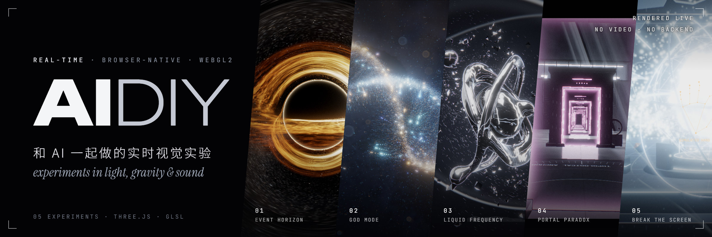

<br>
<br>

[简体中文](README.md) · **English**

<h3>Visual experiments that run live in your browser</h3>

A black hole, a pair of portals, liquid chrome, and a screen you can break from the inside.<br>
Every frame is computed on the GPU as you watch: no video, no baked textures, no server.

<br>


[Works](#works) &nbsp;·&nbsp; [Under the hood](#under-the-hood) &nbsp;·&nbsp; [Principles](#principles) &nbsp;·&nbsp; [Getting started](#getting-started)

</div>

<br>

## Works

<table>
<tr>
<td width="50%" valign="top">
<a href="space/event-horizon">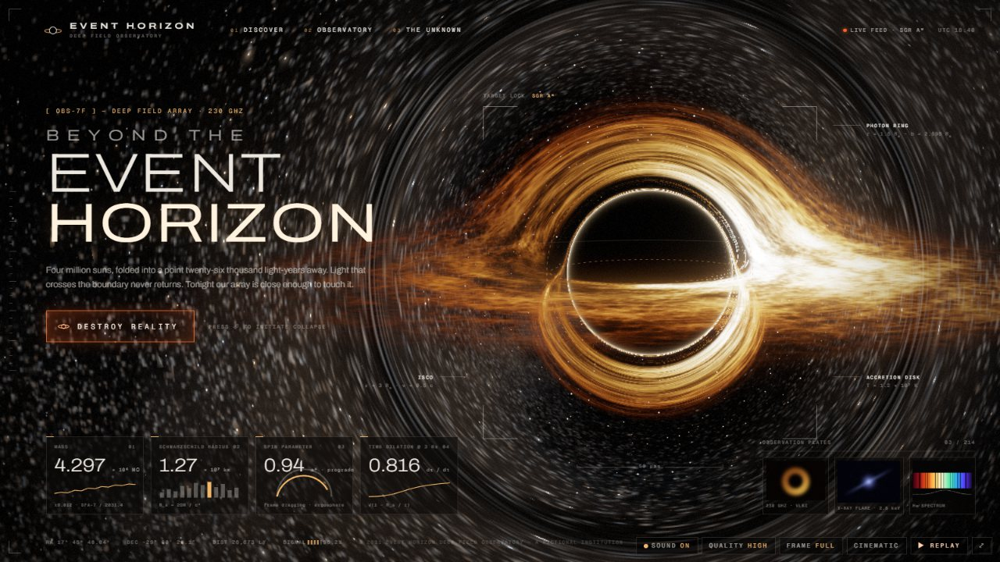</a>
<sub>01 · SPACE</sub><br>
<b>EVENT HORIZON</b><br>
A black hole that devours the web page it lives on.
</td>
<td width="50%" valign="top">
<a href="space/god-mode">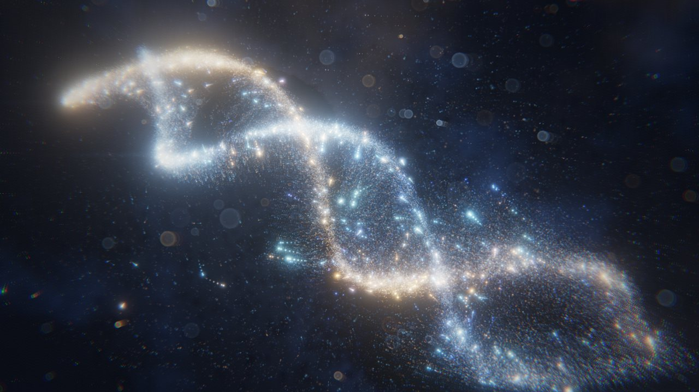</a>
<sub>02 · SPACE</sub><br>
<b>GOD MODE</b><br>
Create, collapse and detonate a 262,000-particle universe with your hands.
</td>
</tr>
<tr>
<td width="50%" valign="top">
<a href="audio-visual/liquid-frequency">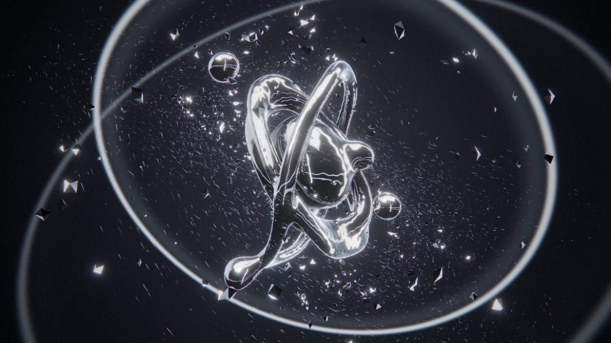</a>
<sub>03 · AUDIO-VISUAL</sub><br>
<b>LIQUID FREQUENCY</b><br>
A liquid chrome sculpture driven by music in real time.
</td>
<td width="50%" valign="top">
<a href="games/portal-paradox">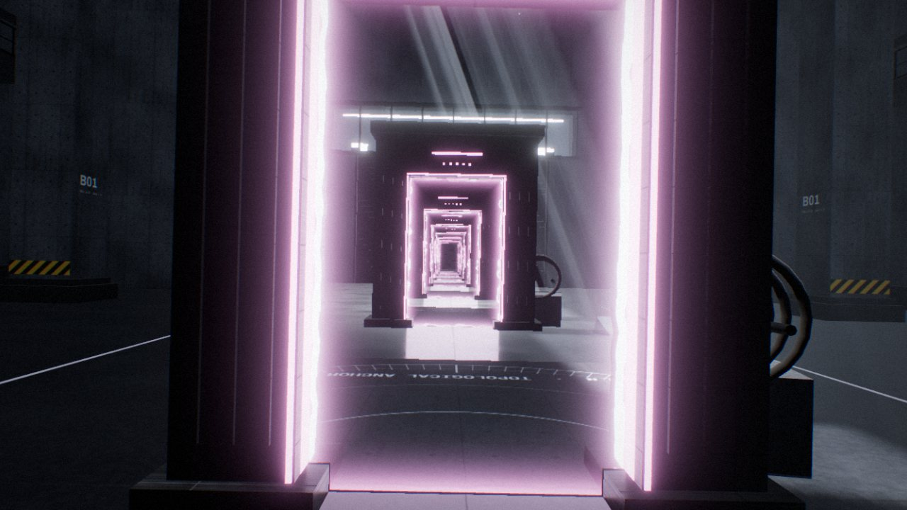</a>
<sub>04 · GAMES</sub><br>
<b>PORTAL PARADOX</b><br>
Two truly connected portals, in a lab where gravity flips and time runs backwards.
</td>
</tr>
<tr>
<td width="50%" valign="top">
<a href="mixed-reality/break-the-screen">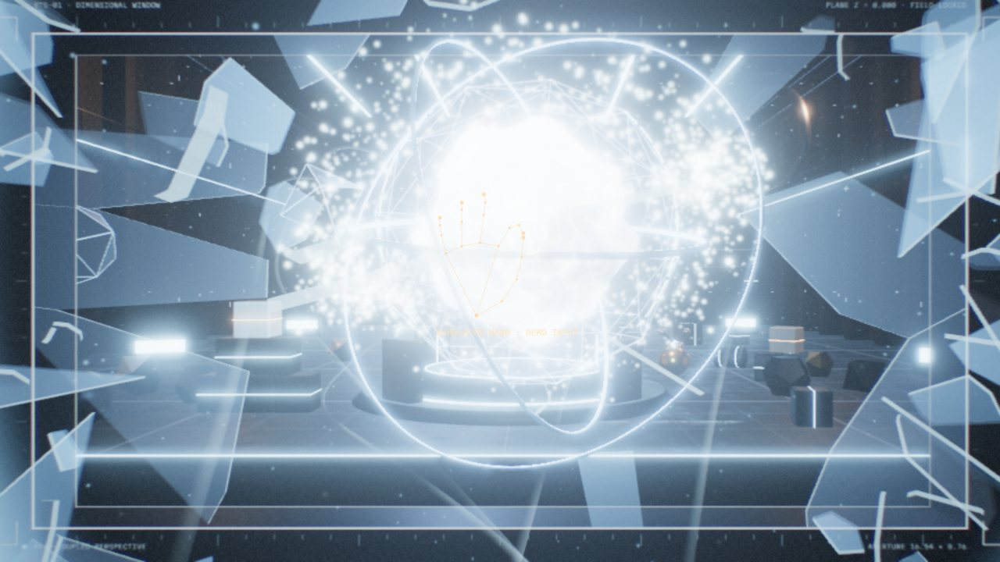</a>
<sub>05 · MIXED REALITY</sub><br>
<b>BREAK THE SCREEN</b><br>
Your screen becomes a window. Reach in and shatter the glass from the inside.
</td>
<td width="50%" valign="top">
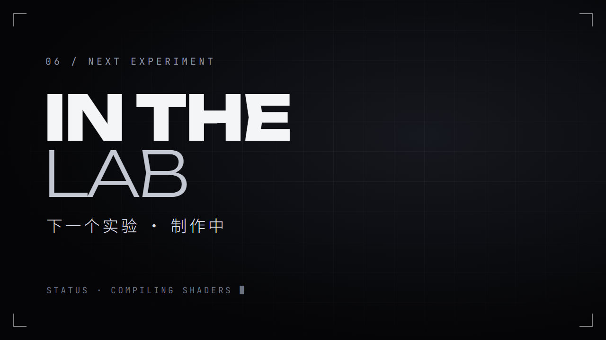
<sub>06 · NEXT</sub><br>
<b>Next experiment</b><br>
In the lab.
</td>
</tr>
</table>

<br>

### 01 — EVENT HORIZON

**What if a black hole could consume the internet?** &nbsp;<sub>[`space/event-horizon`](space/event-horizon)</sub>

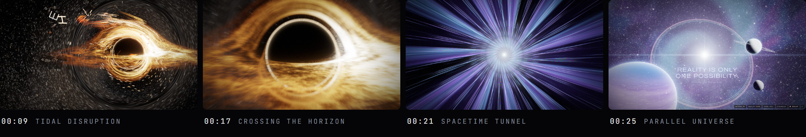

It opens as a polished deep-space observatory website. Press **DESTROY REALITY** and the page's real headings, cards and text are stretched by gravity, torn apart by tidal forces and spiral into the accretion disk. The camera then plunges through the event horizon, down a spacetime tunnel and into another universe. The whole sequence runs about 26 seconds and can be rebuilt and replayed endlessly.

- **The light is computed**: every pixel integrates a photon orbit in the Schwarzschild metric (RK4). The photon ring, gravitational lensing and the Doppler-bright side of the disk all come out of that integration.
- **The page really is torn apart**: DOM elements are first warped with CSS, then handed to WebGL in the same frame. The fragments keep accumulating tidal strain, split again, and burn into particles at the horizon.
- **The sound is synthesized live**: the drone, the tearing, the crossing and the new universe's chord are all generated with Web Audio, with no samples.

<sub><b>TECH</b>&nbsp; React 19 · custom multi-pass Three.js pipeline · GLSL · GSAP · html-to-image &nbsp;&nbsp;|&nbsp;&nbsp; <b>PLAY</b>&nbsp; mouse / keyboard, press <kbd>D</kbd> for the 30-second demo</sub>

<br>

### 02 — GOD MODE

**Control the universe with your hands.** &nbsp;<sub>[`space/god-mode`](space/god-mode)</sub>

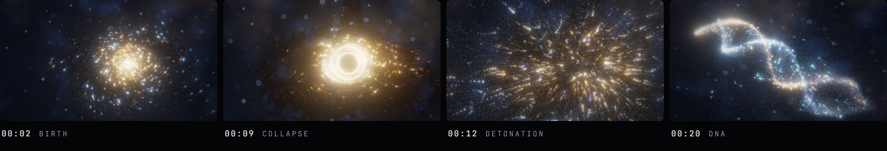

A particle universe that lives entirely on the GPU. Use a mouse, a touch screen, or just gesture at your webcam: make a fist to spin the galaxy, pinch to collapse it into a black hole, open your palm to detonate it, and swipe to morph between galaxy, DNA, nebula, singularity and black hole. Leave it alone and it performs the birth and death of a universe by itself.

- **GPGPU particles**: positions and velocities for up to 262,144 particles are simulated in GPU textures and never touch the CPU per frame. All five forms are generated procedurally from per-particle seeds; no models are stored.
- **A film language**: every form has its own camera shot, with a Vertigo dolly-zoom during collapse, and cinemascope bars, an anamorphic flare and bullet time on detonation.
- **Gesture input**: MediaPipe hand tracking plus a hand-written gesture classifier (unit tested). Devices without WebGL2 fall back to a Canvas 2D version.

<sub><b>TECH</b>&nbsp; TypeScript · Three.js GPUComputationRenderer · GLSL · MediaPipe Tasks Vision · Vitest &nbsp;&nbsp;|&nbsp;&nbsp; <b>PLAY</b>&nbsp; mouse / touch / hand gestures, press <kbd>R</kbd> to replay from the big bang</sub>

<br>

### 03 — LIQUID FREQUENCY

**Make sound visible.** &nbsp;<sub>[`audio-visual/liquid-frequency`](audio-visual/liquid-frequency)</sub>

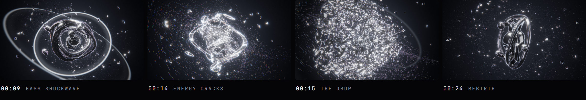

A liquid chrome sculpture played by music. Drop in a track: the bass swells the metal and fires shockwaves, the mids drive its flow and twist, and the highs make the surface shiver and fling off silver shards. The moment a drop is detected, the sculpture bursts into thousands of fragments, hangs in the air, then spirals back under gravity and regrows into a new form.

- **SDF ray marching**: the liquid metal is a distance field ray-marched per pixel, so droplets genuinely merge and split. The chrome reflects a procedural photo studio.
- **Custom audio analysis**: band energies, spectral-flux beat detection, BPM estimation and build-up / drop detection, all processed locally in the browser.
- **An original score**: a 30-second electronic track synthesized live in the browser, with the visuals locked to it beat for beat and no licensed material involved.

<sub><b>TECH</b>&nbsp; React 19 · React Three Fiber · Three.js · GLSL · postprocessing · Web Audio FFT &nbsp;&nbsp;|&nbsp;&nbsp; <b>PLAY</b>&nbsp; drop in music or watch the demo, <kbd>1</kbd>–<kbd>4</kbd> switch forms, <kbd>X</kbd> triggers the climax</sub>

<br>

### 04 — PORTAL PARADOX

**What if space was just an illusion?** &nbsp;<sub>[`games/portal-paradox`](games/portal-paradox)</sub>

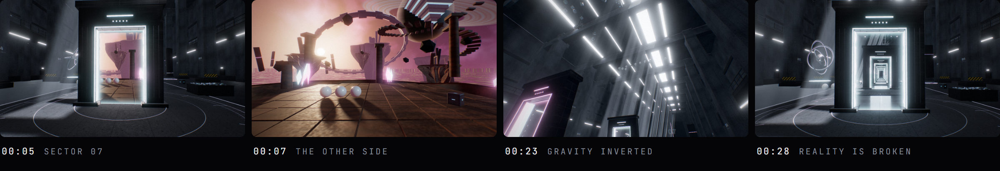

Walk into a 120-metre brutalist concrete research hall in first person. The portal at its centre opens onto another world of islands floating beneath a nebula, a ringed giant planet and an inverted pyramid. What you see through it is a live view of the other side, and walking through takes you there. Face the two portals at each other and an infinite corridor unfolds.

- **Real portals**: every level of recursion is rendered live from its own virtual camera (off-axis sub-frustum plus clipping planes), not a texture or a scaled screenshot, up to 11 levels deep.
- **Conserved momentum**: position, orientation, velocity and angular velocity are all transformed through the portal, so anything you throw in flies out of the other side with its speed and spin intact.
- **Gravity flips and time rewind**: Rapier rigid-body physics. A 10-second ring buffer records the full state of every body, so a rewind can resume the simulation seamlessly from any moment.

<sub><b>TECH</b>&nbsp; React 19 · custom Three.js portal renderer · GLSL · Rapier physics · Vitest &nbsp;&nbsp;|&nbsp;&nbsp; <b>PLAY</b>&nbsp; <kbd>W</kbd><kbd>A</kbd><kbd>S</kbd><kbd>D</kbd> move, <kbd>1</kbd> <kbd>2</kbd> place portals, <kbd>G</kbd> gravity, hold <kbd>R</kbd> to rewind, <kbd>C</kbd> demo</sub>

<br>

### 05 — BREAK THE SCREEN

**Reality has no boundaries.** &nbsp;<sub>[`mixed-reality/break-the-screen`](mixed-reality/break-the-screen)</sub>

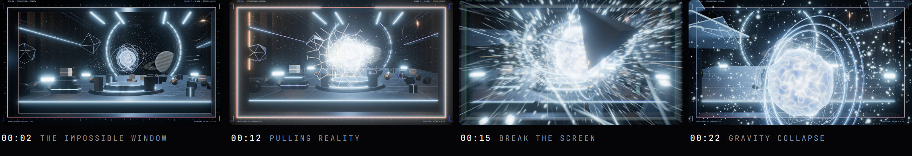

The screen becomes a window into a "dimensional lab". The webcam tracks your head and hands in real time: lean left and you see what was hidden on the right. Pinch to grab the energy core and pull it towards you; it presses against the glass, cracks spread like a spider's web, and the whole pane shatters as the lab pours out of the window. Clap, and everything flies back into place.

- **Head-coupled perspective**: an asymmetric frustum (off-axis projection) is computed from the true position of your eyes, with zero parallax at the screen plane and more the deeper things sit.
- **Glass that breaks**: Voronoi spider-web cracks grow step by step, and on impact every piece becomes a real convex-hull rigid body.
- **Tracking stays on your machine**: MediaPipe face and hand tracking runs in a Web Worker and the camera feed is never uploaded. Without a camera, everything works with a mouse.

<sub><b>TECH</b>&nbsp; React 19 · Three.js · GLSL · Rapier physics · MediaPipe Tasks Vision · Web Worker &nbsp;&nbsp;|&nbsp;&nbsp; <b>PLAY</b>&nbsp; hand gestures + head tracking, or mouse drag, press <kbd>D</kbd> for the 30-second demo</sub>

<br>

## Under the hood

| Technique | How | Work |
|:--|:--|:--|
| General-relativistic ray tracing | Per-pixel RK4 integration of photon orbits in the Schwarzschild metric | EVENT HORIZON |
| DOM → GPU hand-off | Page elements switch from CSS transforms to WebGL fragments within a single frame | EVENT HORIZON |
| GPGPU particle simulation | Positions and velocities of 262k particles ping-ponged in GPU textures | GOD MODE |
| SDF ray marching | Metaball liquid metal that merges and splits, with procedural studio reflections | LIQUID FREQUENCY |
| Real-time audio analysis | FFT band energies, spectral-flux beats, BPM, drop detection | LIQUID FREQUENCY |
| Recursive portal rendering | One virtual camera per recursion level, off-axis sub-frustum plus clipping planes | PORTAL PARADOX |
| Physics state replay | 10-second ring buffer of every rigid body, enabling time rewind | PORTAL PARADOX |
| Off-axis projection | Asymmetric frustum from the viewer's head position turns the screen into a window | BREAK THE SCREEN |
| Voronoi fracture | Spider-web cracks generating convex-hull rigid-body glass shards | BREAK THE SCREEN |
| Hand and face tracking | MediaPipe landmarks plus a hand-written gesture classifier | GOD MODE · BREAK THE SCREEN |
| Procedural sound | Every effect and score synthesized live with Web Audio, no samples | All works |

## Principles

<table>
<tr>
<td width="50%" valign="top">
<b>Real-time, not video</b><br>
Every image is computed by the GPU on the spot. Even the demo sequences are performed live by the engine, not pre-rendered.
</td>
<td width="50%" valign="top">
<b>Open a browser and it runs</b><br>
Pure front end. No backend, and no paid APIs.
</td>
</tr>
<tr>
<td width="50%" valign="top">
<b>Your data stays local</b><br>
Camera frames and the music you load are processed only in your browser and never uploaded to a server.
</td>
<td width="50%" valign="top">
<b>Made for the camera</b><br>
Every work ships with an automatic demo and separate compositions for 16:9 landscape and 9:16 portrait, ready to screen-record.
</td>
</tr>
</table>

## Getting started

You need [Node.js](https://nodejs.org/) 20.19 or newer and a desktop browser with WebGL2 (Chrome or Edge recommended). A webcam is optional.

```bash
git clone https://github.com/Will1202/AIDIY.git
cd AIDIY/space/event-horizon
npm install
npm run dev
```

| Work | Folder | Local URL |
|:--|:--|:--|
| EVENT HORIZON | [`space/event-horizon`](space/event-horizon) | `http://localhost:5181` |
| GOD MODE | [`space/god-mode`](space/god-mode) | `http://localhost:5173` |
| LIQUID FREQUENCY | [`audio-visual/liquid-frequency`](audio-visual/liquid-frequency) | `http://localhost:5178` |
| PORTAL PARADOX | [`games/portal-paradox`](games/portal-paradox) | `http://localhost:5184` |
| BREAK THE SCREEN | [`mixed-reality/break-the-screen`](mixed-reality/break-the-screen) | `http://localhost:5187` |

Each work's folder has a full README (in Chinese, except GOD MODE) covering how it works, every shortcut, recording tips and known limitations.

<br>

<div align="center">
<sub>Built with Three.js, GLSL and Web Audio · Made in collaboration with AI · © 2026 <a href="https://github.com/Will1202">Will1202</a></sub>
</div>
