<div align="center">

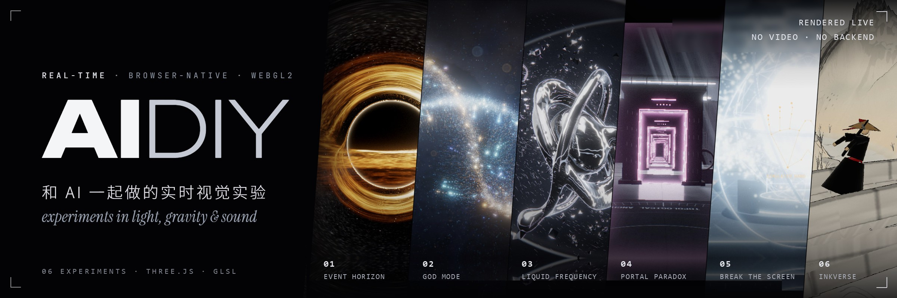

<br>
<br>

**简体中文** · [English](README.en.md)

<h3>在浏览器里实时运行的视觉实验</h3>

黑洞、传送门、液态金属，还有一块会被打碎的屏幕。<br>
每一帧都由 GPU 当场计算：不是视频，不靠贴图，也不需要服务器。

<br>


[作品](#作品) &nbsp;·&nbsp; [技术亮点](#技术亮点) &nbsp;·&nbsp; [创作原则](#创作原则) &nbsp;·&nbsp; [快速开始](#快速开始) &nbsp;·&nbsp; [**▶ 在线体验**](https://will1202.github.io/AIDIY/)

</div>

<br>

## 作品

<table>
<tr>
<td width="50%" valign="top">
<a href="space/event-horizon">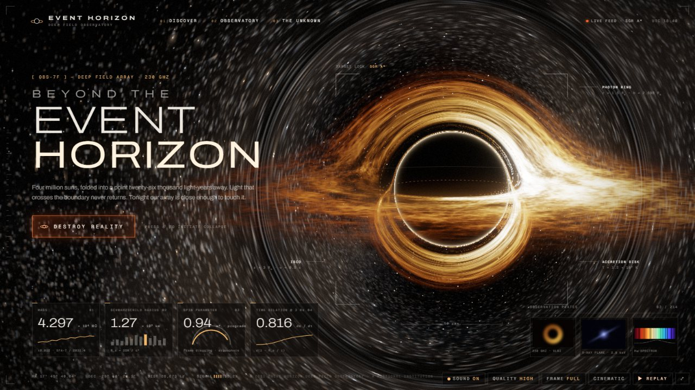</a>
<sub>01 · SPACE · 宇宙与物理</sub><br>
<b>EVENT HORIZON</b><br>
一个会把自己所在网页吞掉的黑洞。<br>
<sub><a href="https://will1202.github.io/AIDIY/event-horizon/">▶ 在线体验</a></sub>
</td>
<td width="50%" valign="top">
<a href="space/god-mode">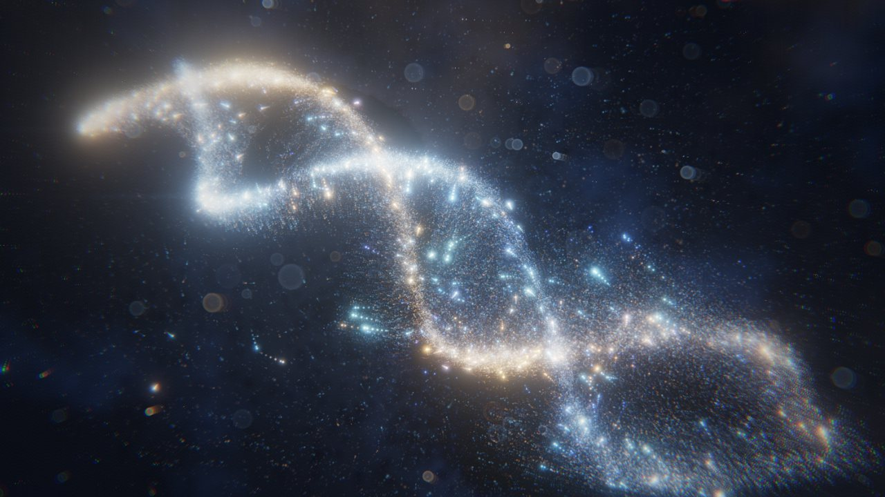</a>
<sub>02 · SPACE · 宇宙与物理</sub><br>
<b>GOD MODE</b><br>
用双手创造、坍缩、引爆一个 26 万颗粒子的宇宙。<br>
<sub><a href="https://will1202.github.io/AIDIY/god-mode/">▶ 在线体验</a></sub>
</td>
</tr>
<tr>
<td width="50%" valign="top">
<a href="audio-visual/liquid-frequency">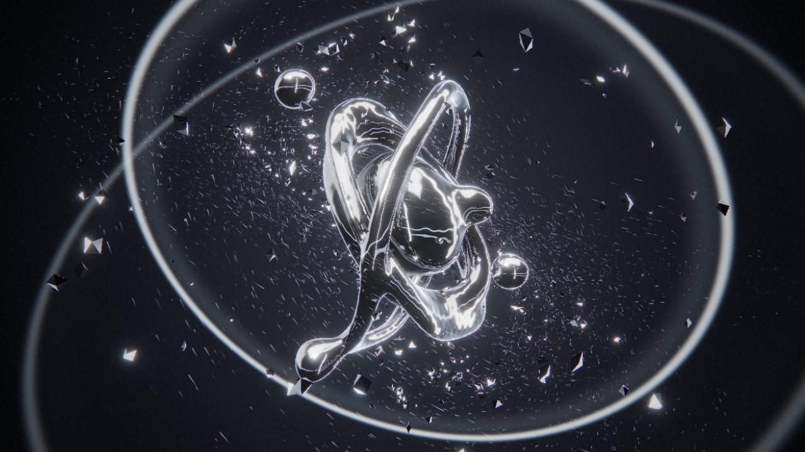</a>
<sub>03 · AUDIO-VISUAL · 声音可视化</sub><br>
<b>LIQUID FREQUENCY</b><br>
被音乐实时驱动的液态铬金属雕塑。<br>
<sub><a href="https://will1202.github.io/AIDIY/liquid-frequency/">▶ 在线体验</a></sub>
</td>
<td width="50%" valign="top">
<a href="games/portal-paradox">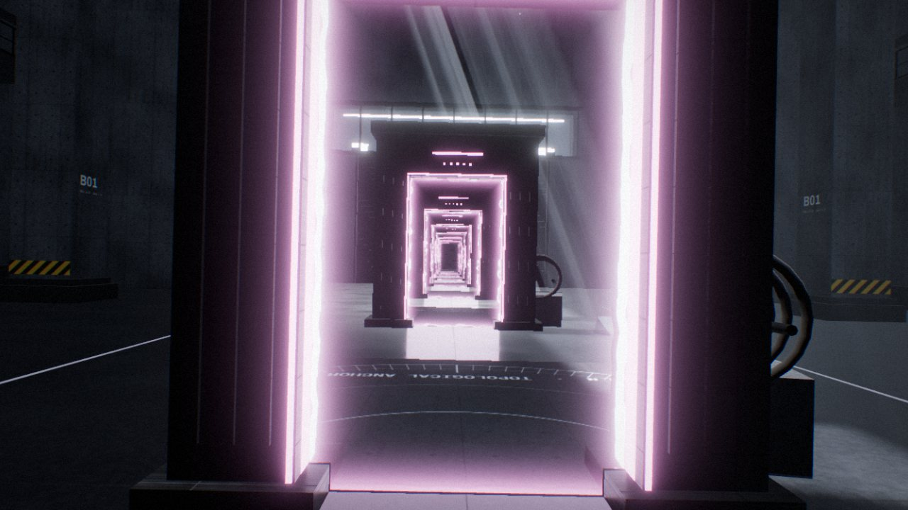</a>
<sub>04 · GAMES · 交互世界</sub><br>
<b>PORTAL PARADOX</b><br>
两扇真正连通的传送门，和一座可以重力反转、时间倒流的实验室。<br>
<sub><a href="https://will1202.github.io/AIDIY/portal-paradox/">▶ 在线体验</a></sub>
</td>
</tr>
<tr>
<td width="50%" valign="top">
<a href="mixed-reality/break-the-screen">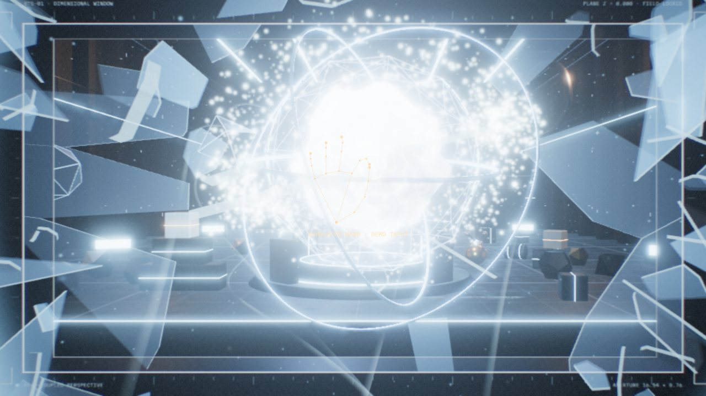</a>
<sub>05 · MIXED REALITY · 体感与混合现实</sub><br>
<b>BREAK THE SCREEN</b><br>
屏幕变成一扇窗，伸手进去，把玻璃从里面打碎。<br>
<sub><a href="https://will1202.github.io/AIDIY/break-the-screen/">▶ 在线体验</a></sub>
</td>
<td width="50%" valign="top">
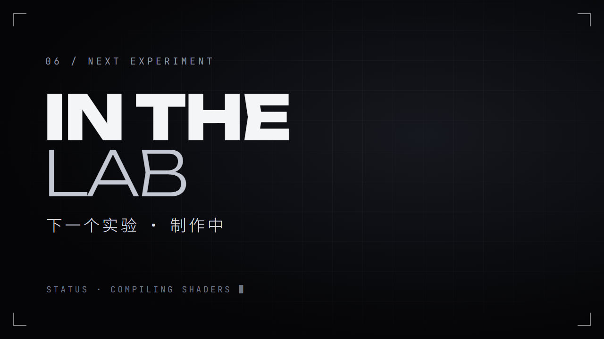
<sub>06 · NEXT</sub><br>
<b>下一个实验</b><br>
制作中。
</td>
</tr>
</table>

<br>

### 01 — EVENT HORIZON

**如果黑洞能吞掉互联网？** &nbsp;<sub>[`space/event-horizon`](space/event-horizon) · [▶ 在线体验](https://will1202.github.io/AIDIY/event-horizon/)</sub>

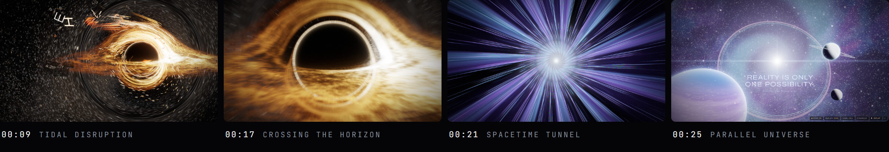

打开是一个精致的"深空观测站"网站。按下 **DESTROY REALITY**，页面上真实的标题、卡片和文字被引力拉扯、潮汐撕裂、螺旋坠入吸积盘；随后镜头冲过事件视界，穿过时空隧道，抵达另一个宇宙。整段约 26 秒，可以反复重建、重播。

- **光线是算出来的**：每个像素都在 Schwarzschild 度规下对光子轨道做 RK4 积分，光子环、引力透镜、吸积盘一侧亮一侧暗的多普勒效应都由此而来。
- **网页是真的被撕碎**：DOM 元素先在 CSS 里被拉伸扭曲，再在同一帧无缝交给 WebGL，碎片继续累积潮汐应变、二次撕裂，最后烧蚀成粒子被视界吞没。
- **声音是实时合成的**：低频嗡鸣、撕裂、穿越、新宇宙的和弦，全部由 Web Audio 生成，没有任何采样。

<sub><b>技术</b>&nbsp; React 19 · Three.js 自研多 pass 管线 · GLSL · GSAP · html-to-image &nbsp;&nbsp;|&nbsp;&nbsp; <b>操作</b>&nbsp; 鼠标 / 键盘，按 <kbd>D</kbd> 播放 30 秒演示</sub>

<br>

### 02 — GOD MODE

**用双手控制宇宙。** &nbsp;<sub>[`space/god-mode`](space/god-mode) · [▶ 在线体验](https://will1202.github.io/AIDIY/god-mode/)</sub>

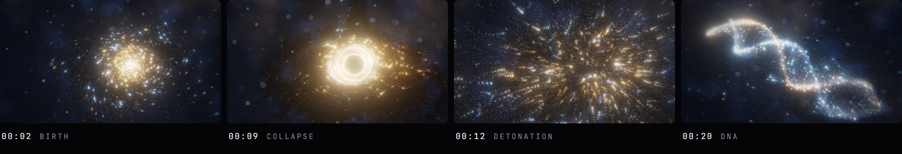

一个完全运行在 GPU 上的粒子宇宙。用鼠标、触屏，或者直接对着摄像头比手势：握拳让星系旋转，捏合让它坍缩成黑洞，张开手掌把它引爆，横向挥手在星系、DNA、星云、奇点、黑洞五种形态之间变换。没人操作时，它会自己演完一整段宇宙的诞生与毁灭。

- **GPGPU 粒子**：最多 26 万颗粒子的位置和速度都在 GPU 纹理里计算，每帧不经过 CPU；五种形态由每颗粒子的随机种子程序化生成，不存储任何模型。
- **镜头语言**：每种形态都有自己的机位，坍缩时希区柯克式变焦，引爆时宽银幕黑边、横向镜头光晕和子弹时间。
- **手势识别**：MediaPipe 手部追踪加自写的手势分类器（带单元测试）；不支持 WebGL2 的设备会自动降级为 Canvas 2D 版本。

<sub><b>技术</b>&nbsp; TypeScript · Three.js GPUComputationRenderer · GLSL · MediaPipe Tasks Vision · Vitest &nbsp;&nbsp;|&nbsp;&nbsp; <b>操作</b>&nbsp; 鼠标 / 触屏 / 摄像头手势，按 <kbd>R</kbd> 从大爆炸重播</sub>

<br>

### 03 — LIQUID FREQUENCY

**让声音变成物质。** &nbsp;<sub>[`audio-visual/liquid-frequency`](audio-visual/liquid-frequency) · [▶ 在线体验](https://will1202.github.io/AIDIY/liquid-frequency/)</sub>

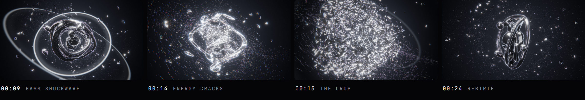

一件被音乐实时驱动的液态铬金属雕塑。拖进一首歌，低音让金属膨胀、打出冲击波，中频控制流动和扭曲，高频让表面细颤、甩出银色碎片。检测到 drop 的瞬间，雕塑炸成几千块碎片，悬浮片刻，再被引力螺旋吸回，长成新的形态。

- **SDF 光线步进**：液态金属是逐像素光线步进出来的距离场，液滴之间能真正融合、分裂；铬面反射的是程序化生成的摄影棚灯光。
- **自研音频分析**：分频段能量、谱通量节拍检测、BPM 估计、build-up / drop 识别，音频只在本地浏览器中处理。
- **原创配乐**：内置一首 30 秒原创电子乐，由浏览器实时合成，画面与乐谱逐拍同步，不涉及任何版权素材。

<sub><b>技术</b>&nbsp; React 19 · React Three Fiber · Three.js · GLSL · postprocessing · Web Audio FFT &nbsp;&nbsp;|&nbsp;&nbsp; <b>操作</b>&nbsp; 拖入音乐或直接看 DEMO，<kbd>1</kbd>–<kbd>4</kbd> 切换形态，<kbd>X</kbd> 触发高潮</sub>

<br>

### 04 — PORTAL PARADOX

**如果空间只是一种错觉？** &nbsp;<sub>[`games/portal-paradox`](games/portal-paradox) · [▶ 在线体验](https://will1202.github.io/AIDIY/portal-paradox/)</sub>

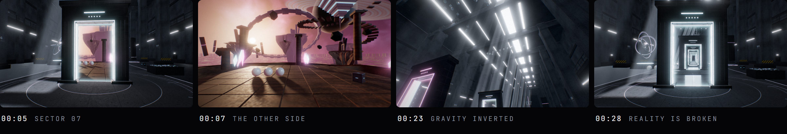

第一人称走进一座 120 米长的粗野主义混凝土实验大厅。中央的传送门连着另一个世界：星云下漂浮的岛屿、带环的巨行星、倒悬的金字塔。门里看到的是另一边的实时画面，走过去就真的到了那边；把两扇门面对面放，就会出现层层嵌套的无限走廊。

- **真正的传送门**：每一层递归都从自己的虚拟相机实时渲染（偏轴子视锥 + 裁剪面），不是贴图，也不是缩放的截图，最高 11 层。
- **动量守恒**：人和物体穿门时，位置、朝向、速度、角速度一起变换；扔进去的东西会带着原来的速度和旋转从另一扇门飞出来。
- **重力反转与时间倒流**：Rapier 刚体物理；10 秒环形缓冲记录所有物体的完整状态，倒放后从任意时刻无缝续算。

<sub><b>技术</b>&nbsp; React 19 · Three.js 自研传送门渲染器 · GLSL · Rapier 物理 · Vitest &nbsp;&nbsp;|&nbsp;&nbsp; <b>操作</b>&nbsp; <kbd>W</kbd><kbd>A</kbd><kbd>S</kbd><kbd>D</kbd> 移动，<kbd>1</kbd> <kbd>2</kbd> 放门，<kbd>G</kbd> 重力，按住 <kbd>R</kbd> 倒流，<kbd>C</kbd> 演示</sub>

<br>

### 05 — BREAK THE SCREEN

**现实没有边界。** &nbsp;<sub>[`mixed-reality/break-the-screen`](mixed-reality/break-the-screen) · [▶ 在线体验](https://will1202.github.io/AIDIY/break-the-screen/)</sub>

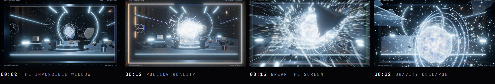

屏幕变成一扇通往"维度实验室"的窗户。摄像头实时追踪你的头和手：头往左移，就能看到窗里原本被挡住的右侧；捏合手指抓住能量核心，把它往自己这边拉，它会顶在屏幕玻璃上，裂纹像蛛网一样蔓延，然后整块碎掉，整个实验室从窗口里冲出来。拍一下手，一切飞回原位。

- **视点相关透视**：按眼睛的真实位置实时计算非对称视锥（Off-Axis Projection），屏幕平面零视差，越远的物体视差越大。
- **可以碎的玻璃**：Voronoi 蛛网裂纹逐步蔓延，碎裂时每一块都变成真实的凸包刚体。
- **识别在本机完成**：MediaPipe 人脸与手部识别运行在 Web Worker 里，画面不上传；没有摄像头时可以用鼠标体验全部效果。

<sub><b>技术</b>&nbsp; React 19 · Three.js · GLSL · Rapier 物理 · MediaPipe Tasks Vision · Web Worker &nbsp;&nbsp;|&nbsp;&nbsp; <b>操作</b>&nbsp; 摄像头手势 + 头部追踪，或鼠标拖拽，按 <kbd>D</kbd> 播放 30 秒演示</sub>

<br>

## 技术亮点

| 技术 | 做法 | 作品 |
|:--|:--|:--|
| 广义相对论光线追踪 | Schwarzschild 度规下逐像素 RK4 积分光子轨道 | EVENT HORIZON |
| DOM → GPU 交接 | 网页元素在同一帧从 CSS 变换无缝切换为 WebGL 碎片 | EVENT HORIZON |
| GPGPU 粒子模拟 | 26 万粒子的位置、速度在 GPU 纹理中 ping-pong 计算 | GOD MODE |
| SDF 光线步进 | 可融合、分裂的元球液态金属，程序化摄影棚反射 | LIQUID FREQUENCY |
| 实时音频分析 | FFT 分频段能量、谱通量节拍、BPM、drop 识别 | LIQUID FREQUENCY |
| 递归传送门渲染 | 每层递归独立虚拟相机，偏轴子视锥 + 裁剪面 | PORTAL PARADOX |
| 物理状态回放 | 10 秒环形缓冲记录全部刚体状态，支持时间倒流 | PORTAL PARADOX |
| 离轴投影 | 按头部位置实时计算非对称视锥，屏幕成为一扇窗 | BREAK THE SCREEN |
| Voronoi 碎裂 | 蛛网裂纹生成凸包刚体玻璃碎片 | BREAK THE SCREEN |
| 手势与人脸追踪 | MediaPipe 关键点 + 自写手势分类器 | GOD MODE · BREAK THE SCREEN |
| 程序化声音 | Web Audio 实时合成全部音效与配乐，不含任何采样 | 全部作品 |

## 创作原则

<table>
<tr>
<td width="50%" valign="top">
<b>实时，而不是视频</b><br>
每个画面都是 GPU 当场算出来的。演示动画也是引擎实时演出，不是预渲染。
</td>
<td width="50%" valign="top">
<b>打开浏览器就能运行</b><br>
纯前端，没有后端，也不调用任何付费 API。
</td>
</tr>
<tr>
<td width="50%" valign="top">
<b>数据留在本机</b><br>
摄像头画面和上传的音乐只在本地浏览器中处理，不会上传到任何服务器。
</td>
<td width="50%" valign="top">
<b>为镜头而生</b><br>
每个作品都内置自动演示，并为横屏 16:9 与竖屏 9:16 分别设计构图，可以直接录制短视频。
</td>
</tr>
</table>

## 快速开始

不想安装的话，所有作品都可以直接在线体验：<https://will1202.github.io/AIDIY/>

需要 [Node.js](https://nodejs.org/) 20.19 及以上版本，以及支持 WebGL2 的桌面浏览器（推荐 Chrome 或 Edge）。摄像头是可选的。

```bash
git clone https://github.com/Will1202/AIDIY.git
cd AIDIY/space/event-horizon
npm install
npm run dev
```

| 作品 | 目录 | 本地地址 |
|:--|:--|:--|
| EVENT HORIZON | [`space/event-horizon`](space/event-horizon) | `http://localhost:5181` |
| GOD MODE | [`space/god-mode`](space/god-mode) | `http://localhost:5173` |
| LIQUID FREQUENCY | [`audio-visual/liquid-frequency`](audio-visual/liquid-frequency) | `http://localhost:5178` |
| PORTAL PARADOX | [`games/portal-paradox`](games/portal-paradox) | `http://localhost:5184` |
| BREAK THE SCREEN | [`mixed-reality/break-the-screen`](mixed-reality/break-the-screen) | `http://localhost:5187` |

每个作品目录里都有一份完整的 README，包含实现原理、全部快捷键、录屏建议和已知限制。

<br>

<div align="center">
<sub>用 Three.js、GLSL 和 Web Audio 构建 · 与 AI 协作创作 · © 2026 <a href="https://github.com/Will1202">Will1202</a></sub>
</div>
