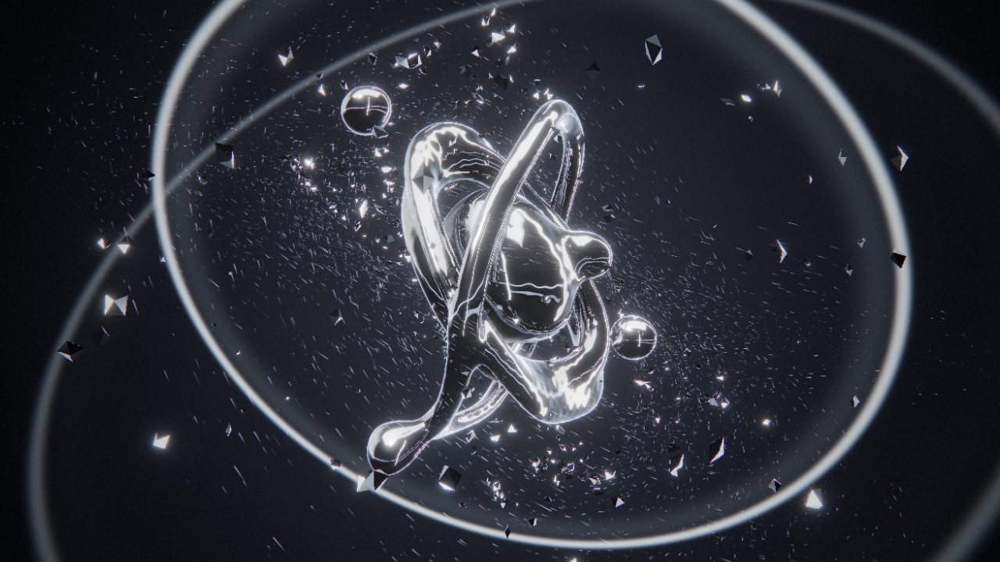

<sub><a href="../README.md">← AIDIY</a></sub>

# AUDIO-VISUAL · 声音可视化

由声音驱动的视觉作品。可以接入你自己的音乐，由浏览器在本地做实时频谱分析；也可以直接使用内置的原创配乐，它由浏览器实时合成，不涉及任何版权素材。

<a href="liquid-frequency"></a>

**LIQUID FREQUENCY**：被音乐实时驱动的液态铬金属雕塑。低音让它膨胀，高频让它颤动；drop 的瞬间炸成几千块碎片，再被引力吸回，长成新的形态。<br>
<sub>拖入音乐，或直接看 30 秒 DEMO · <kbd>1</kbd>–<kbd>4</kbd> 切换形态 · <code>localhost:5178</code> · <a href="https://will1202.github.io/AIDIY/liquid-frequency/">▶ 在线体验</a></sub>

```bash
cd audio-visual/<作品目录>
npm install
npm run dev
```
