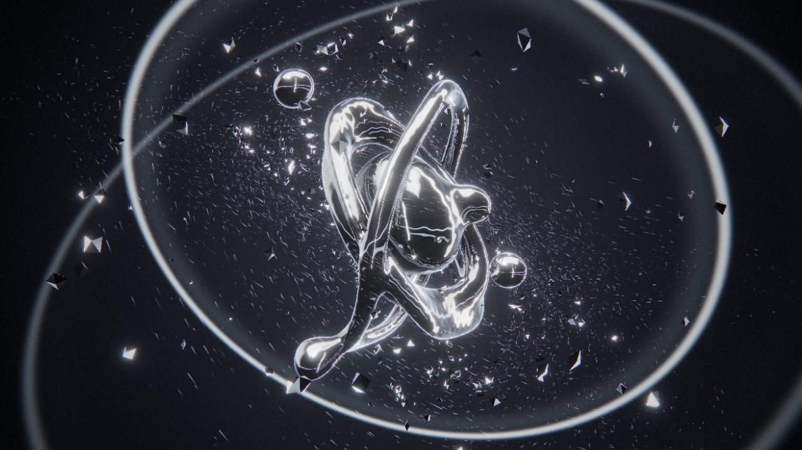

<sub><a href="../../README.md">← AIDIY</a></sub>



# LIQUID FREQUENCY — MAKE SOUND VISIBLE

> SOUND BECOMES MATTER.

一件由真实音乐实时驱动的 3D 液态铬金属雕塑。浏览器原生运行：光线步进（Raymarching）的 SDF 液态金属 + GPU 粒子物理碎片 + Web Audio FFT 实时分析。所有音频只在本地浏览器处理，不上传任何服务器，不依赖任何付费 API。

---

## 启动

**在线体验**：<https://will1202.github.io/AIDIY/liquid-frequency/>（不用安装，打开就能玩；你拖进来的音乐只在本机浏览器里分析）

本地运行：

需要 Node.js 20.19+（Vite 8 的最低要求，已在 Node 24 上验证）。

```bash
cd audio-visual/liquid-frequency
npm install
npm run dev
```

浏览器打开 <http://localhost:5178>。

生产构建与预览：

```bash
npm run build
npm run preview
```

强制画质档位（默认自动检测）：在地址后加 `?q=high`、`?q=medium` 或 `?q=low`。

---

## 操作说明

| 操作 | 功能 |
| --- | --- |
| **ENTER EXPERIENCE** | 进入体验，自动开始 DEMO（原创合成电子乐 + 30 秒编排） |
| **LOAD AUDIO** / 拖拽文件到窗口任意位置 | 上传本地音乐（MP3 / WAV / OGG / M4A / FLAC 等），切换到实时 FFT 分析 |
| `1` – `4` | 切换四种雕塑形态 |
| `Space` | 播放 / 暂停 |
| `X` 或 TRIGGER CLIMAX 按钮 | 手动触发「爆炸与重生」高潮 |
| `C` | 电影模式（Cinematic）开 / 关 |
| `A` | 画幅切换：全屏 · 16:9 · 9:16 |
| `H` | 隐藏 / 显示界面（保留普通镜头） |
| `F` | 浏览器全屏 |
| `M` | DEMO 合成器静音 |
| `P` / 双击（手机双击） | 能量脉冲 |
| 鼠标拖拽 / 滚轮（手机单指 / 双指捏合） | 旋转视角 / 推拉镜头 |
| 鼠标移动 | 液态金属被光标"磁场"吸引隆起，碎片被推开 |
| `Esc` | 退出电影模式 / 关闭面板 |
| `?` | 快捷键面板 |

---

## 两种信号源（严格区分）

左上角徽章始终标明当前驱动来源：

- **DEMO · SCRIPTED SIGNAL** — 程序编排的信号。视觉读取一份 30 秒乐谱（`src/audio/demoScore.ts`），同一份乐谱也驱动 Web Audio 实时合成的原创电子乐（`DemoSynth.ts`），两者共用 AudioContext 时钟，所以声画同步。这**不是**音频分析，界面上也不会冒充。
- **LIVE FFT ANALYSIS** — 你上传的音乐，经 `AnalyserNode`（FFT 2048）实时分析驱动一切。

### DEMO 配乐

一首原创的旋律电子乐，128 BPM、A 小调，全部由浏览器实时合成，没有任何采样文件。128 BPM 下 30 秒正好 16 小节，15 秒的 drop 落在第 9 小节的正拍上。

- **和声**：Am9 · Fmaj7 · G6 · Em7 · Cmaj7 · Gsus，去根音的声部连接铺底（每音 3 个失谐声部、立体声展开）。
- **旋律**：drop 段有一条原创主旋律（E D C D E | C A C D E | G E D C D | B D～），单音连奏、带滑音，长音会长出颤音；结尾用 FM 钟声慢速回响开头的动机，落回 A。
- **琶音**：全程 16 分音符拨弦琶音，经附点八分的乒乓延迟，滤波随段落逐渐打开。
- **律动**：四拍底鼓；pad 和贝斯跟着底鼓做侧链"呼吸"；drop 段是滚动 16 分贝斯 + 开镲。
- **空间与母带**：渐暗的立体声混响尾音，胶水压缩 + tanh 软削波。离线渲染测得峰值约 −0.8 dBFS、无削波。

### DEMO 30 秒编排

| 时间 | 音乐 | 画面 |
| --- | --- | --- |
| 0 – 3.75 s | pad 渐起、闷音琶音、远处钟声 | 黑暗中，银色液态金属缓缓浮现 |
| 3.75 – 7.5 s | 底鼓 + 反拍贝斯进入 | 金属随节奏呼吸、扭曲 |
| 7.5 – 13.1 s | 拍手、16 分镲、琶音变亮 | 低音冲击波、冲击环、形态变化 |
| 13.1 – 15 s | 底鼓抽掉、军鼓滚奏、上升音效、Gsus 悬而未决 | 金属高速扭转、内部能量裂纹亮起 |
| 15 s | DROP：重击 + 和弦 stab + 主旋律 | 雕塑崩解为数千块三维碎片，闪光 + 屏幕冲击波 |
| 15 – 20.6 s | 主旋律、滚动贝斯、侧链律动 | 碎片云悬浮，仍随鼓点脉动 |
| 20.6 – 26 s | 鼓点退场、主旋律最后一音延续、半速律动 | 中心引力把碎片螺旋吸回，液态金属重新长出新的形态 |
| 26.25 – 30 s | 钟声回响主题、落回 Am9 | 镜头环绕，标题 LIQUID FREQUENCY 出现，淡出循环 |

---

## 音频分析（`src/audio/FeatureExtractor.ts`）

- **频段能量**：Bass 30–160 Hz、Mid 400–2600 Hz、Treble 2.6–12 kHz，按线性幅度 RMS 计算后转 dB。
- **动态范围处理**：每个频段有自适应"地板 / 天花板"（天花板瞬间上升、每秒回落 3 dB；地板瞬间下降、缓慢上升；动态范围限制在 20–42 dB），所以安静和响亮的歌曲都能用满 0–1 的视觉范围；静音门限防止底噪被放大。各频段有独立的 attack / release 平滑。
- **节拍 / 瞬态**：半波整流的对数幅度谱通量（spectral flux），低频段（≤180 Hz）用于鼓点，全频段用于瞬态；自适应阈值 = 近 48 帧均值 + k·标准差，带不应期。
- **BPM**：近 24 个节拍间隔的中位数，折叠到 70–180 BPM。
- **Build-up / Drop**：短期与长期包络（开头会快速预热，避免把前奏误判成能量突增）。高频上升 + 低频变薄 → tension；tension 峰值之后出现的第一个强低频鼓点，或持续的能量突增 → 触发高潮。高潮有 20 秒冷却，普通波动不会反复引爆。

### 声音 → 形态 映射

| 信号 | 视觉 |
| --- | --- |
| Bass / 鼓点 | 整体膨胀后弹性回缩、表面向外扩散的形变波、碎片被冲击推开、环境灯闪、能量冲击环、镜头轻震 |
| Mid | 液体流动速度、域扭曲幅度、雕塑旋转、卫星液滴的靠近 / 融合 / 分离 |
| Treble | 表面细密振动、高光沿边缘扫过、碎片脱离主体形成高速银色粒子流（停止后回到主体）、尘埃拖尾变长 |
| Tension（build-up） | 内部能量裂纹预热 |
| Drop | 爆炸与重生 |

---

## 四种形态

1. **CHROME HEART** — 三条交织的铬金属缎带 + 脉动核心 + 会融合与撕裂的卫星液滴（真正的 smooth-min 元球，可分裂与重新融合）。
2. **MERCURY OCEAN** — 悬浮水银团：漩涡、低音大尺度形变、高音细密波纹与尖峰、被甩出又落回的液滴。
3. **SHATTERED REALITY** — 由碎片组成的三叶结（trefoil knot）雕塑 + 外围光环；音乐越强碎片越激烈，低音向外推开，安静时重新聚拢。
4. **SINGULARITY** — 旋转能量核心 + 极向喷流 + 万向节铬环 + 开普勒吸积盘碎片 + 向心螺旋粒子流；高潮时整体向中心坍缩后爆发。

模式切换不是换颜色：液态部分在 SDF 层面连续形变过渡，碎片带惯性错峰飞向新的结构。

---

## 电影模式 / 录屏

按 `C`：界面自动隐藏、光标 1.8 秒后隐藏、镜头改为更流畅的电影轨迹（缓慢环绕 + 高度起伏 + 呼吸推拉），高潮时自动推近再拉远。按 `A` 选 **9:16**（抖音 / TikTok 竖屏）或 **16:9**（B 站横屏），画面会在窗口中央裁出对应画幅，标题卡与水印也在画幅内。录屏建议：

1. 浏览器全屏（`F`），电影模式（`C`），选好画幅（`A`）。
2. DEMO 自带 30 秒完整叙事，可直接录；或上传一首有明显 build-up 和 drop 的歌。
3. 想在指定时刻爆发，按 `X`。

---

## 技术实现

- **React 19 + TypeScript + Vite 8**，**Three.js 0.186** 通过 **React Three Fiber 9** 渲染，后期用 **postprocessing**。
- **液态金属**（`src/gl/shaders/liquid.ts`）：在包围球内做 SDF 光线步进；smooth-min 元球、正弦域扭曲、传播式冲击波、扭转形变；四面体法线采样、环境光遮蔽、高档位下的二次自反射；用最近距离做轮廓抗锯齿；写入 `gl_FragDepth`，碎片和粒子能与液态金属正确遮挡。
- **铬材质**（`src/gl/shaders/chunks.ts`）：程序化摄影棚环境——顶部柔光箱、侧面柔光板、三条环绕灯条、地平线亮线、底部冷色补光、始终位于主体背后的轮廓光。Schlick 菲涅尔 + 银色 F0 + 锐利 GGX 风格高光。灯条随高频扫动、随鼓点闪烁，所以高光是"流动"的。
- **碎片**（`src/gl/Shards.tsx`）：`GPUComputationRenderer` 做 GPGPU 物理（位置 / 速度纹理），弹簧-阻尼回到各模式的家位置，节拍冲量、爆炸冲量、螺旋引力、旋涡场、鼠标磁斥力；单个 Instanced 几何体、平面着色晶体。没有任何随机生成 / 销毁。
- **尘埃流**：无状态的解析轨道，相位由 CPU 积分（速度变化不会跳帧），每个粒子是一条短光迹。
- **后期**：HDR mipmap Bloom → 合并的一次调色 Pass（高潮屏幕冲击波折射、鼓点驱动的色差、曝光闪光、ACES、冷暗部调色、暗角、感知空间胶片颗粒）。
- **性能**：自适应 DPR（掉帧降分辨率，有余量再升回）、按设备分档（光线步进步数 / 二次反射 / 碎片数 / 粒子数）、每帧零对象分配、组件卸载时释放 GPU 资源和音频节点。

### 目录

```
src/
  audio/    AudioEngine（上下文、播放、错误处理）· FeatureExtractor（FFT 分析）
            DemoConductor（编排信号）· DemoSynth（原创合成器）· demoScore（30 秒乐谱）
  engine/   engine（每帧状态编排）· climax（爆炸重生状态机）· quality（画质分档）
  gl/       Stage · CameraRig · LiquidSculpture · Shards · Effects · PostFX · shaders/
  ui/       Intro · HUD · Overlays
  state/    zustand UI 状态
```

---

## 已验证 / 未验证

已在本机（AMD Radeon 860M 核显，Chrome 内核）实际运行并检查：

- `tsc` 类型检查与 `vite build` 生产构建通过。
- 首页、四种模式、完整 30 秒 DEMO（包括扭曲 → 能量 → 爆炸 → 悬浮 → 引力回收 → 重组 → 标题）、电影模式 9:16、手机竖屏布局都做了截图检查。
- 用程序生成的测试 WAV（律动 → 无鼓 build-up → drop）走真实 FFT 路径：节拍逐个命中、BPM 识别为 119.9（实际 120）、tension 在 build-up 中升到 0.99、高潮在 drop 的第一个鼓点触发、前奏没有误触发。
- 非音频文件、损坏的 MP3、播放结束、拖动进度都有对应提示和状态处理。
- 键盘快捷键（1–4、X、C、Esc、Space）通过真实按键测试。
- GPU 单帧耗时（1248×702 画布、最高档）：各模式及高潮期间约 3.9–5.4 ms；按像素线性推算 1080p 约 10–13 ms。

未能验证：

- 测试用的浏览器面板处于后台节流状态，**无法测得真实窗口下的实时 FPS**——界面右下角会显示实时 FPS / DPR / 档位，请以你自己的屏幕为准。
- 没有用真实商业歌曲测试（测试音轨是程序合成的）；也没有在实体手机或 Safari 上测试。

---

开发模式下控制台可用 `__lf.bench(30)` 测 GPU 帧耗时，`__lf.scrub(15)` 把 DEMO 确定性地推进到指定秒数（会静音）。
