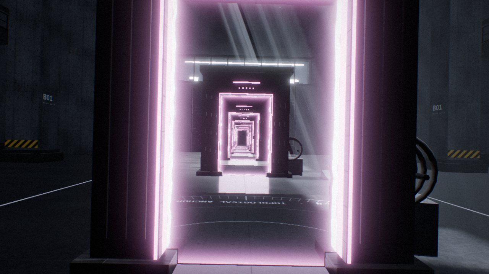
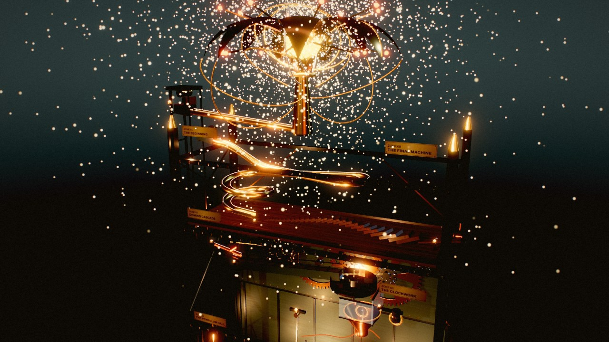
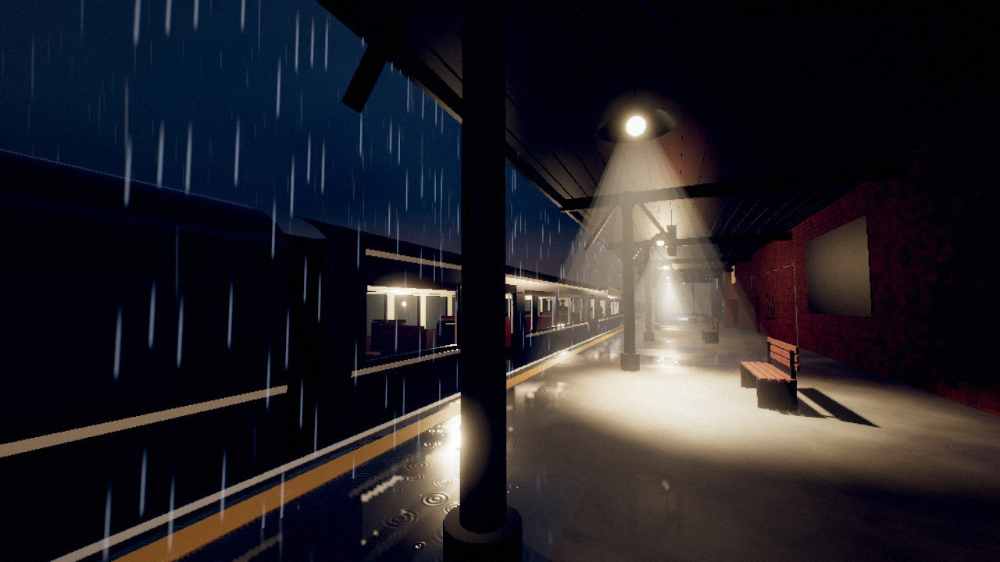

<sub><a href="../README.md">← AIDIY</a></sub>

# GAMES · 交互世界

可以走进去、亲手去玩、甚至亲手搭建的 3D 世界。渲染和物理都是实时计算的，并且都带一段可以直接录屏的自动演示。

<a href="portal-paradox"></a>

**PORTAL PARADOX**：两扇真正连通的传送门，把一座粗野主义实验大厅和一个漂浮在星云下的世界缝在一起。可以穿门、把东西扔过去、面对面放出无限递归，还能让重力反转、让时间倒流。<br>
<sub>键盘鼠标第一人称 / 触屏 · 按 <kbd>C</kbd> 播放 30 秒演示 · <code>localhost:5184</code> · <a href="https://will1202.github.io/AIDIY/portal-paradox/">▶ 在线体验</a></sub>

<a href="chain-reaction"></a>

**CHAIN REACTION · 万象机关**：一颗弹珠撬动一座 8 区机械塔。多米诺、杠杆、齿轮、传送带、转盘、滑轮、摆锤、弹簧发射器、升降机，全部由真实刚体物理一环一环传递，最后点亮塔顶的终极装置；可以时间倒流，也可以进入建造模式自己搭。<br>
<sub>鼠标观察 · <kbd>Space</kbd> 播放 · <kbd>B</kbd> 倒流 · 首页 WATCH CINEMATIC 播放电影模式 · <code>localhost:5193</code> · <a href="https://will1202.github.io/AIDIY/chain-reaction/">▶ 在线体验</a></sub>

<a href="the-last-train"></a>

**THE LAST TRAIN · 永不抵达的末班列车**：午夜 00:00，你在暴雨中的零号站台醒来，手里是一张没有目的地的车票。列车穿行于六个世界——倒悬都市、深海终点站、时间沙漠、记忆博物馆、不存在的终点——每个世界都有自己的物理规则和必须真的解开的谜题，一路上的发现与选择决定三个结局。<br>
<sub>键盘鼠标第一人称 / 触屏 · <kbd>E</kbd> 交互 · <kbd>C</kbd> 电影模式 · <kbd>P</kbd> 拍照 · 主菜单「展映模式」回放标志性时刻 · <code>localhost:5196</code> · <a href="https://will1202.github.io/AIDIY/the-last-train/">▶ 在线体验</a></sub>

```bash
cd games/<作品目录>
npm install
npm run dev
```
