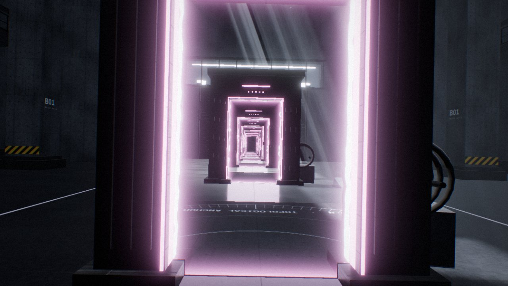

<sub><a href="../README.md">← AIDIY</a></sub>

# GAMES · 交互世界

可以第一人称走进去、亲手去玩的 3D 世界。渲染和物理都是实时计算的，并且都带一段可以直接录屏的自动演示。

<a href="portal-paradox"></a>

**PORTAL PARADOX**：两扇真正连通的传送门，把一座粗野主义实验大厅和一个漂浮在星云下的世界缝在一起。可以穿门、把东西扔过去、面对面放出无限递归，还能让重力反转、让时间倒流。<br>
<sub>键盘鼠标第一人称 / 触屏 · 按 <kbd>C</kbd> 播放 30 秒演示 · <code>localhost:5184</code> · <a href="https://will1202.github.io/AIDIY/portal-paradox/">▶ 在线体验</a></sub>

```bash
cd games/<作品目录>
npm install
npm run dev
```
