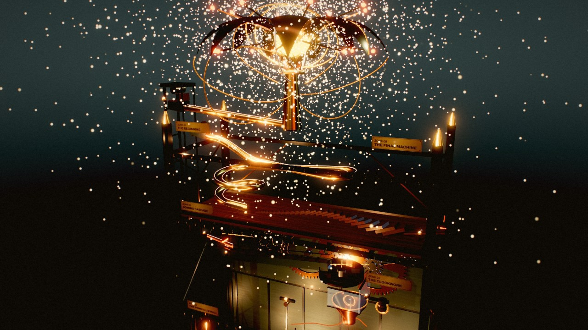

<sub><a href="../../README.md">← AIDIY</a></sub>



# CHAIN REACTION — THE BUTTERFLY MACHINE

**ONE MARBLE. A THOUSAND CONSEQUENCES. · 一颗小球，撬动整个世界。**

一座 30 米高、分成 8 个区域的黄铜机械塔。按下 START，顶端的闸门放出一颗钢珠：它滚下凹槽轨道、钻过螺旋、撞倒 26 块越来越大的多米诺；最后一块砸翻杠杆，杠杆顶下开关，电机带动四级齿轮，凸轮打开落球器，传送带和转盘把三颗弹珠送进滑轮吊桶；吊桶压下去、配重升上来、松开摆锤的锁扣，16 kg 的摆锤撞上扳机，弹簧把第三颗球射过半座塔，升降机把它送上 18 米高的塔顶，最后它滚进终点杯——塔顶的巨大球体展开、齿轮转动、机械臂伸出、金色粒子绽放。

整条链上的每一次"传递"都是真实发生的：刚体碰撞、关节约束、测量出来的传感器状态，或者一根看得见的信号线。没有任何一个机关是按时间表自己动起来的；如果某一环没成功，后面的机关就不会动，界面会告诉你断在了哪里、为什么。

## 运行

**在线体验**：<https://will1202.github.io/AIDIY/chain-reaction/>

```bash
cd games/chain-reaction
npm install
npm run dev        # http://localhost:5193
npm test           # 17 项自动测试（含整台机器 10 次带装配误差的完整运行）
npm run build      # tsc 类型检查 + 生产构建 → dist/
npm run trial -- 30 3   # 命令行无头试验：30 次、每个零件 ±3 mm 随机装配误差
```

需要支持 WebGL2 的桌面浏览器（推荐 Chrome / Edge）。地址参数：`?cinematic` 直接播放电影模式，`?build` 直接进入建造模式，`?play` 跳过首页。

## 三种玩法

| 入口 | 内容 |
|:--|:--|
| **START THE MACHINE** | 运行预制的 THE GRAND CONTRAPTION。左侧"因果链"实时显示每个机关的状态（IDLE / ARMED / ACTIVATED / RUNNING / COMPLETED / FAILED）和进度，右上角是模拟时间、已触发数、最近事件、物理步频与求解耗时。 |
| **BUILD YOUR OWN** | 建造模式：从组件库放置轨道和机关，拖拽 / 旋转 / 调参 / 接线，存档、导入导出 JSON，然后 START SIMULATION。 |
| **WATCH CINEMATIC** | 面向短视频的电影模式：黑场推近机械塔 → 放出第一颗球 → 镜头跟着真实事件切换，各区标题在对应机关真正触发时出现 → 终极装置 → 片尾字卡 → 重播。 |

### 控制

| 操作 | 说明 |
|:--|:--|
| PLAY / PAUSE / RESET | <kbd>Space</kbd> 播放暂停，<kbd>R</kbd> 重置（按同一份场景文件完整重建物理世界） |
| REWIND | <kbd>B</kbd> 时间倒流：倒下的多米诺重新站起、弹珠沿原路退回、齿轮倒转；再按一次停在当前时刻，PLAY 从这里重新模拟 |
| SPEED | 0.25× / 0.5× / 1× / 2×：改变的是每秒执行多少个固定物理步（1/120 s），步长本身不变 |
| CAMERA | <kbd>C</kbd> 切换：AUTO DIRECTOR · OVERVIEW · FOLLOW MARBLE · MACRO · FREE（拖拽旋转、右键平移、滚轮缩放；一动鼠标自动进入 FREE）。点击左侧因果链里的任一机关可以给它一个特写 |
| QUALITY | LOW / MEDIUM / HIGH / ULTRA：分辨率、MSAA、阴影、泛光级数、粒子数、铆钉、几何细分、环境贴图。**物理在所有档位完全相同** |
| FRAME | FULL / 16:9 / 9:16：竖屏不是裁切，导演按画幅比例重新计算机位距离和构图 |

建造模式快捷键：<kbd>G</kbd> 移动 · <kbd>R</kbd> 旋转 · <kbd>Q</kbd>/<kbd>E</kbd> 转 15° · <kbd>[</kbd>/<kbd>]</kbd> 工作平面高度 · <kbd>Ctrl D</kbd> 复制 · <kbd>Del</kbd> 删除 · <kbd>Ctrl Z</kbd>/<kbd>Ctrl Y</kbd> 撤销重做 · <kbd>Esc</kbd> 取消。

## THE GRAND CONTRAPTION：14 个阶段

下面的时间是标称装配下的实测值（无头模拟与浏览器内结果逐帧一致）。

| 时间 | 区域 | 机关 | 怎么传递到下一环 | 驱动方式 |
|--:|:--|:--|:--|:--|
| 0.00 | 01 THE BEGINNING | 释放闸门 + 陡降坡、直道、180° 回头弯、1.5 圈螺旋 | 闸门抬起，钢珠靠重力滚动 | START 信号 → 物理 |
| 10.96 | 02 DOMINO CASCADE | 26 块逐渐变大的多米诺（最后一块 1.06 m、10.8 kg） | 每一块都是独立刚体，只靠碰撞传递 | 物理碰撞 |
| 15.24 | 03 THE CLOCKWORK | 杠杆（真实转轴关节） | 最后一块骨牌砸下输入端，输出端抬起 | 物理 + 关节 |
| 15.42 | 03 | 按钮开关（弹簧柱塞） | 杠杆把按钮顶过触发深度 → 信号线 | 传感器 |
| 15.42 | 03 | 电机 + 四级齿轮 | 收到 start 才通电；齿轮按齿数比传动，相邻反转 | 电机 + 运动学约束 |
| 16.31 | 03 | 凸轮落球器（3 颗弹珠） | 凸轮转过 30° 顶开闸门 | 机械联动 |
| — | 04 GRAVITY ENGINE | 链条传动的板条传送带 → 链条传动的转盘 | 板条和后掠叶片真实推动弹珠；转盘缺口把球甩进挡板和接球漏斗 | 电机经齿轮 + 物理 |
| 26.19 | 04 | 滑轮吊桶 + 配重 | 配重相当于 1.5 颗弹珠，**至少两颗**落进桶里才会下降 | 物理（1 自由度绳索模型） |
| 28.75 | 05 THE PENDULUM HALL | 锁扣 + 16 kg 摆锤 | 配重升到行程 85% 触发锁扣 → 销子退出 → 摆锤靠重力摆下 | 传感器 + 物理 |
| 29.75 | 06 SPRING CHAMBER | 弹簧发射器 | 摆锤真实撞开扳机板 → 卡扣释放 → 关节弹簧（F = k·x − c·v）推动柱塞 | 物理 + 关节弹簧 |
| — | 06 | 5 米弹道飞行 → 毛毡网 + 漏斗 + 竖管 + 装载槽 | 抛体飞行，漏斗竖管消除旋转后落进滑槽 | 物理 |
| 35.37 | 07 THE ASCENSION | 称重升降机（18.4 m） | 轿厢检测到弹珠静止 0.3 s 后绞车启动，到顶开闸，V 形地板把球居中送出 | 传感器 + 电机 |
| 45.46 | 08 THE FINAL MACHINE | 塔顶轨道 → 终点杯 | 弹珠在杯中静止 0.2 s 才算触发 | 传感器 |
| +14 s | 08 | 终极装置演出 | 外壳 8 瓣展开、4 道环形仪、16 条伸缩机械臂、核心点火、最多 2.4 万颗金色粒子 | 事件触发的程序化演出 |

完整一次约 45 秒物理时间 + 14 秒终极演出。电影模式里的节奏调整（落球段 1.8×、弹射段 0.55× 慢动作、升降段 1.5×）同样由真实事件触发，只改变物理步的调度速度，不跳过、不伪造任何事件。

## 实现

```
src/sim/         纯 TypeScript 模拟核心（不依赖 three.js / DOM，可在 Node 里无头运行）
  physics.ts       Rapier 世界、固定 1/120 s 步长、材质、接触起始事件 → 碰撞速度
  component.ts     机关基类：状态机、信号输入输出、吸附接口、保存 / 恢复
  components/      18 种机关（轨道、漏斗、弹珠、落球器、平台、挡板、多米诺、杠杆、按钮、
                   电机、齿轮、传送带、转盘、滑轮、摆锤、弹射器、升降机、终点）
  mechanics.ts     齿轮传动：按几何自动识别啮合（同平面、中心距 = 节圆半径之和）
  simulation.ts    触发图（信号线）、事件日志、停滞看门狗与失败原因
  recorder.ts      时间倒流：每 2 步记录全部刚体位姿 / 速度 / 休眠 + 每个机关的内部状态
  grandContraption.ts  预制机械塔（用和编辑器相同的吸附规则搭出来）
  serialize.ts / validate.ts   版本化场景 Schema、导入校验、结构性检查
src/render/      Three.js：HDR 管线 + 双滤波泛光 + ACES、PBR 材质、塔体建筑、各机关外观、终极装置
src/camera/      阻尼相机、事件驱动的自动导演
src/audio/       Web Audio 实时合成：碰撞、滚动、电机、齿轮、弹簧、锁扣、终极和弦、环境配乐
src/editor/      建造模式：放置、吸附、TransformControls、撤销重做、存档、3D 缩略图
```

- **物理**：Rapier 3D（`@dimforge/rapier3d-compat` 0.21），固定步长 1/120 s，求解器 8 次迭代，弹珠和柱塞开启 CCD。速度控制只改变每帧执行几个固定步；超过每帧 12 步的上限时模拟会变慢，而不是放大步长，所以 2× 也不会让弹珠穿透轨道。
- **轨道**：半管凹槽的三角网格碰撞体，开启 `FIX_INTERNAL_EDGES`。最初用的是双导轨 + 护栏的胶囊体链，实测在弯道里有 50% 以上的非物理能量损失（连无摩擦都会掉 90% 速度），换成凹槽后直道速度与滚动小球理论值吻合，弯道里球会像真实弹珠机一样自己爬上外侧形成倾角。看到的轨道网格就是碰撞体本身。
- **齿轮**：用稳定的运动学传动代替逐齿碰撞：啮合由几何自动判定，角速度按 ω₂ = −ω₁·N₁/N₂ 传播，齿相位自动对齐，所以齿是真的咬合着转。传送带、转盘、凸轮通过显式的"链条"连接从齿轮取力。
- **区分三种运动**：多米诺、杠杆、摆锤、吊桶、柱塞、弹珠是**物理驱动**；电机、齿轮、传送带、转盘、升降机是**电机驱动**（运动学刚体，照样能推动物体）；按钮、锁扣、升降机称重、终点杯是**传感器激活**。HUD 和编辑器里每个机关都标着自己的驱动方式。
- **失败是真的会发生的**：看门狗在"5 秒内没有任何状态变化且所有刚体静止"或"30 秒内没有任何状态变化"时判定失败，并指出最后一个触发的机关和下一个没被触发的机关以及原因，例如"Domino Cascade fired, but Tipping Lever was never activated — nothing pushed the input end down"。
- **时间倒流**：录制最近 90 秒（60 Hz）。倒放时进入回放模式，物理暂停、逐帧写回记录；停下后从那一刻恢复刚体与机关状态，丢弃被覆盖的"未来"重新模拟。
- **确定性**：同一份场景在 Node 无头模拟和浏览器里逐阶段时间完全一致（都是 45.46 s），这也是能做大量无头测试的基础。

## 实际测试结果

`npm test`（vitest，17 项，约 30 秒）全部通过：

| # | 测试 | 结果 |
|:--|:--|:--|
| 01 | 小球在重力下真实加速（与滚动小球理论 a = g·sinθ/1.4 相差在 25% 以内，位置不是插值出来的） | 通过 |
| 02 | 小球连续通过陡降坡、180° 弯、直道、1.5 圈螺旋和 4 处轨道接缝，不脱轨 | 通过 |
| 03 | 多米诺严格按顺序倒下；**对照组**：不撞第一块就一块都不倒 | 通过 |
| 04 | 摆锤转轴不漂移，周期符合物理摆 | 通过 |
| 05 | 无人触碰 / 球放在旁边时开关不触发，球砸在杠杆上才触发；升降机和终点杯对飞过的球不响应 | 通过 |
| 06 | 整台机器从第一颗球运行到终极装置，11 个关键阶段按因果顺序触发 | 通过 |
| 07 | 中途暂停再继续，与不间断运行的全部刚体状态逐位相同 | 通过 |
| 08 | 重置后的世界与新建世界的全部刚体与机关状态完全一致 | 通过 |
| 09 | 10 种随机装配误差（±2 mm、±1.5 mrad）下完整运行 | **10 / 10 成功** |
| 10 | 自动导演只在真实状态变化之后切镜（骨牌镜头不会早于第一块骨牌倾倒） | 通过 |
| 11 | 场景保存 → 解析 → 位置、参数、连线完全一致，且重新加载的机器仍能跑完；损坏文件被拒绝并给出原因 | 通过 |
| 12 | 倒流到 12 秒：已倒下的骨牌重新站起，全部位姿等于当时的记录（不是初始状态）；从该点继续模拟仍能跑完 | 通过 |
| — | 预制机器没有结构性错误；人为抬高一段轨道、剪断开关信号线会被校验器报出 | 通过 |

额外的无头压力测试（`npm run trial` / `scripts/seeds.ts`）：

| 装配误差 | 次数 | 成功到达终极装置 |
|:--|--:|--:|
| 无（标称） | 1 | 1 / 1 |
| ±2 mm、±1.5 mrad | 10 | 10 / 10 |
| ±3 mm、±1.5 mrad | 30 | 30 / 30 |
| ±4 mm、±1.5 mrad | 50 | 48 / 50（两次都断在"转盘 → 吊桶"：三颗球里只有一颗进桶） |

浏览器内验证（Claude 内置浏览器，Windows · AMD Radeon 860M 核显）：首页、HUD、因果链、控制栏、自动导演各区镜头、时间倒流（26 块骨牌按记录逐块立回）、建造模式（3D 缩略图、轨道吸附到落球器出口坐标完全重合、保存 → 加载 → 撤销 → 重做、导入损坏 JSON 被拒绝）、电影模式、9:16 竖屏都实际跑过并截图检查。性能实测（1280×720，含物理步进并等待 GPU 完成）：LOW 6.2 ms / 帧、MEDIUM 7.8 ms、HIGH 8.2 ms。

## 已知限制与未完成项

- **没有分岔轨道**：组件库里有直道、陡降坡、弯道、螺旋、跳台和漏斗，Y 形分岔 / 换向器还没做。
- **滑轮是 1 自由度模型**：吊桶在竖直滑轨上，绳子用"配重惯量并入吊桶 + 2·m·g 拉力"的理想滑轮方程代替，不是绳索物理；传送带和转盘的链条传动画成发光的传动线，不是逐节链条。
- **校验是启发式的**：能发现轨道断层、方向偏差、悬空轨道、没有支撑的骨牌、未接线的电机 / 锁扣、到不了的终点，但不能证明一台新机器一定能跑通——要跑一次才知道。
- **±4 mm 下仍有约 4% 的失败率**，集中在需要两颗弹珠的吊桶段；标称装配下每次都成功。
- **声音没有人耳验证**：音频图在浏览器里能正常创建和调度，但这个环境里听不到声音，音色和响度需要你亲自听一下再调。
- **编辑器的鼠标拖拽**：放置、吸附、选择、参数、存档都用真实的指针事件和 API 测过；TransformControls 的拖动手柄没有用真实鼠标逐一拖过。
- 只在 Windows 的 Chromium 内核浏览器里测过；Safari、Firefox 和手机没有测试。整体时长约 45 秒，比"30 秒短视频"长，电影模式靠事件触发的变速来压缩节奏。

## 录屏建议

- 横屏：FRAME 选 16:9、CAMERA 选 AUTO DIRECTOR，点 CINEMATIC，录到片尾字卡出现。
- 竖屏：FRAME 选 9:16，再点 CINEMATIC；导演会按竖屏重新取景。
- 想要更细的画面：QUALITY 切到 HIGH / ULTRA（物理不变，只影响渲染）。
