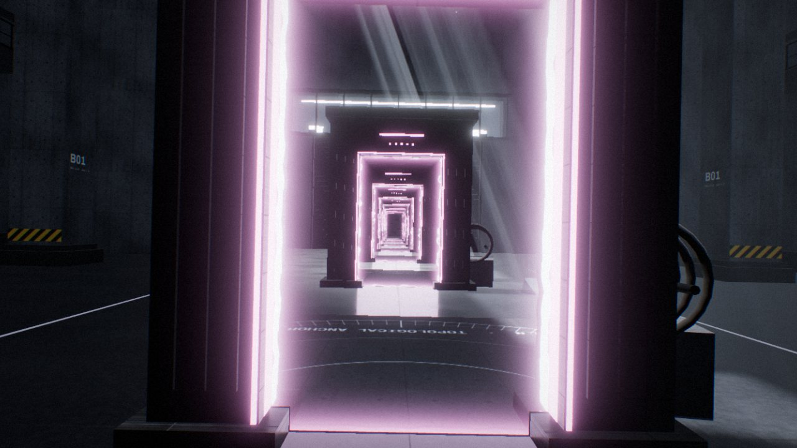

<sub><a href="../../README.md">← AIDIY</a></sub>



# PORTAL PARADOX — REALITY IS BROKEN

**What if space was just an illusion?**

一个在浏览器里实时运行的"时空实验室"。一座巨大的粗野主义（Brutalist）混凝土实验大厅，和一个漂浮在星云下的超现实世界，被两扇真正连通的传送门 α / Ω 缝在一起。你可以走过去、把东西扔过去、把两扇门面对面放出无限递归、让实验室重力反转，再把最近几秒钟倒放回去。

所有画面都是实时渲染 + 实时物理，没有预渲染视频，也没有贴图假装的传送门。

## 运行

```bash
cd games/portal-paradox
npm install
npm run dev        # http://localhost:5184
npm run build      # tsc 类型检查 + 生产构建 → dist/
npm run preview    # 预览生产构建
npm test           # 传送门数学的单元测试（vitest）
```

需要支持 WebGL2 的桌面浏览器（推荐 Chrome / Edge）。地址后加 `?showcase` 打开后自动播放 30 秒演示；加 `?debug` 在生产构建里也打开测试接口 `window.__PP`。

## 操作

| 操作 | 按键 |
|---|---|
| 移动 / 冲刺 / 跳跃 | `W A S D` / `Shift` / `Space` |
| 视角 | 鼠标（进入后自动锁定指针，`Esc` 释放并打开设置） |
| 拾取 / 放下 | `E` 或鼠标右键（3.6 m 内，可隔着传送门拿另一边的东西） |
| 投掷 / 动能脉冲 | 鼠标左键（手里有东西就扔出去；空手时把准星下的物体推开，22 m 内，同样穿门生效） |
| 传送门放置工具 α / Ω | `1` / `2` 选中，瞄准地面出现预览框，左键放下，`[` `]` 旋转，再按一次取消 |
| 重力反转 | `G` |
| 时间倒流 | 按住 `R`（松开即从倒流到的那一刻继续模拟） |
| 布局：GATEWAY / MIRROR | `L`（GATEWAY = 实验室 ⇄ 另一侧世界；MIRROR = 两扇门在实验室里面对面） |
| 30 秒电影演示 | `C`（再按一次提前结束） |
| 重置世界 | `X` |
| 录屏画框 全屏 / 16:9 / 9:16 | `V` |
| 画质 LOW / MEDIUM / HIGH / ULTRA | `Q` |
| 隐藏 HUD / 快捷键帮助 | `H` / `?` |
| 全屏 / 静音 | `F` / `M` |

触屏设备会自动出现移动端操作：左手虚拟摇杆移动（推到底冲刺），右半屏拖动看，右下角按钮跳跃、拾取、投掷、重力、倒流、α/Ω 工具、暂停。

## 录制 30 秒短视频

1. Chrome 打开，`F` 全屏，`Q` 切到 HIGH（独显可以 ULTRA）。
2. 竖屏视频先按 `V` 切到 `9:16` 画框（画面会居中成竖条，镜头自动加宽垂直视角）；横屏用 `16:9` 或全屏。
3. OBS 60 fps 开录，按 `C`。演示正好 30 秒，结束后回到菜单，可以反复录。

演示时间线（全部调用真实的渲染、穿越和物理系统）：

| 时间 | 内容 |
|---|---|
| 0–4 s | 黑暗的实验大厅，只有天窗漏下的一道光；顶灯由近到远依次闪亮；传送门 α 通电、光圈张开 |
| 4–9 s | 镜头推向 α，透过门看到另一个世界，真正穿过门（不黑屏、不切镜头），升起越过漂浮岛 |
| 9–14 s | 回身看 Ω，透过 Ω 能看到实验室；实验室里的电磁炮把金属立方体射进 α，它从 Ω 飞出来，继续翻滚、弹跳 |
| 14–20 s | 镜头穿回实验室；Ω 从另一个世界"拔出来"，在实验室里重新锚定、正对 α，门内出现层层嵌套的无限走廊；镜头连续两次飞过 Ω，每次都回到同一条走廊 |
| 20–25 s | 重力反转：几十个物体（立方体金字塔、铬球、玻璃多面体、玻璃碎片、罐体）同时砸向 26 m 高的天花板 |
| 25–30 s | 时间倒流：所有物体沿刚才的轨迹倒飞回原位，重力恢复；镜头停在两门之间，PORTAL PARADOX / REALITY IS BROKEN. |

字幕是页面上的 DOM 动画（逐字展开的大标题 + 左下角章节卡），会一起被录进去。

## 实现说明：哪些是真的，哪些是近似

### 传送门渲染（`src/portal/PortalRenderer.ts`）

- **真实的双向实时传送门**。两扇门之间的变换是 `T(P→Q) = M_Q · R_y(π) · M_P⁻¹`，那个 180° 旋转让"走进 P 的正面"变成"从 Q 的正面走出来"。两面都是活的：从背面进 P，就从 Q 的背面出来。
- **每一层都是真渲染**。对每扇看得见的门，沿着 `C_k = T^k · C_0` 生成一串虚拟相机，最深的一层先渲染，P 的门面在第 k 层里采样第 k+1 层的结果（每扇门两张渲染目标来回交替）。所以面对面的两扇门会出现真正的嵌套空间，每一层都有自己正确的透视，不是缩放的截图。递归层数：LOW 2 / MEDIUM 4 / HIGH 7 / ULTRA 11，门在屏幕上小于若干像素就停。
- **透视正确**。每一层用主相机投影矩阵的"偏轴子视锥"，只覆盖门在屏幕上的矩形，并且只渲染到渲染目标里对应的那块视口。像素和全屏投影一一对应，门面直接用 `gl_FragCoord` 采样；three.js 的视锥剔除也自动缩到门洞范围，越深的层越便宜。
- **裁剪**。虚拟相机通常站在出口门的背后（比如墙里），出口平面上加一个全局裁剪面，相机和出口之间的东西一律不画。
- **近处不穿帮**。相机贴近门面时，门面会变成一个向远离相机方向延伸的薄盒子，近裁剪面永远切不到"门后面"。
- 门里看到的雾是按虚拟相机到物体的总路程算的，所以越深的递归层越朦胧，自然形成无限深度感。

### 穿越（`src/portal/PortalMath.ts`，有单元测试）

- 玩家用**眼睛的位置**判定：这一帧和上一帧的眼睛位置是否从门平面的一侧跨到另一侧，并且交点落在门洞内。位置、朝向（只绕 Y 轴）、速度一起变换。
- 平面两侧按 `z ≥ 0` / `z < 0` 划分，刚好站在平面上的点不会被判两次；传送后新位置已经在出口的外侧，所以不需要冷却时间也不会来回抖动。已测：正向、反向、从门背面进入、连续 6 次快速来回穿越。
- 玩家移动每个渲染帧做一次（Rapier 运动学角色控制器：坡道、台阶、贴墙滑动、推开物体），所以判定用的眼睛就是被渲染的那只眼睛，没有物理插值和画面之间的错位。

### 物体穿越（`src/physics/Props.ts`）

- 物理固定 60 Hz 步长，渲染在两步之间插值，所以 60 / 120 / 144 Hz 显示器上运动一致。
- 刚体**中心**越过门洞时，整个刚体状态过门：位置、旋转、线速度、角速度都用同一个变换映射，然后继续模拟。实测：门之间相对旋转 270° 时，进 α 速度 (0.28, −0.71, −6.02) → 出 Ω (6.02, −0.87, 0.28)，和理论值一致（y 的差是一步重力）。
- **视觉上的连续穿越是近似**：物体卡在门中间时，本体只画门这一侧的部分，另一个世界里同时画一个"出口分身"，只画已经出来的部分（逐物体裁剪面，阴影也跟着裁剪）。但**物理碰撞体只有一个**，在中心越界的那一刻才搬过去；所以门后若紧贴着墙，半个物体在门里时仍会和那面墙碰撞。门都是独立站立的，正常玩法里碰不到这种情况。
- 拿在手里的东西也会跟着穿门：持握点隔着门时，自动映射到门的另一侧。

### 重力反转（`G`）

只有实验室的重力场翻转（另一侧世界的物体不受影响，跨过门的物体会立即进入对方世界的重力），由 Rapier 正常解算碰撞和惯性。天窗上有一块看不见的"玻璃"，翻转后的物体不会从天窗飞走。目前不翻转玩家自己。

### 时间倒流（`R`）

**这是记录与回放，不是逆向物理。** 每个物理步之后把每个物体的位置、旋转、线速度、角速度、所在世界、穿门次数写进 10 秒的环形缓冲区。倒流时暂停求解器，播放头在历史里往回走，相邻两帧之间连续插值（跨越传送门的那一帧不插值，直接切换，避免两个世界之间"拖影"）。松开时把播放头那一刻的完整状态（包括速度和当时的重力方向）写回 Rapier，并丢弃之后的"未来"。实测：翻转重力 2.5 秒、全部物体撞上天花板后倒流回去，所有物体回到原位的误差小于 1.2 mm。

### 画面

- **实验室**：120 m 长、44 m 宽、26 m 高的混凝土大厅，柱列、横梁、夹层走道、人尺度的小门（用来衬托尺度）、尽头 21 m 高的"巨门"、控制室窗带。混凝土是程序生成的板模混凝土纹理（模板缝、对拉螺栓孔、气孔、雨痕），世界空间三平面映射。
- **天窗光**：阳光只能从屋顶一条长缝进来。哪里被晒到是逐像素解析计算的（往太阳方向射线是否穿过缝、是否被横梁挡住），所以地上那道光带边缘永远锐利、半影随距离变宽；阴影贴图只需要画可移动的物体。体积光是解析的光线与斜切盒求交，加上沿光线方向的条纹和横梁投下的缝隙。
- **另一个世界**：烘焙到立方体贴图的天空（星云、带环巨行星、双太阳、云海、星星），程序生成的漂浮岛，520 m 的光环、倒悬的阶梯金字塔、绕行的黑色巨石碑、悬空楼梯、发光晶簇、上升的光尘。
- 后期：HDR 渲染、自写的 13-tap 多级 bloom、ACES 色调映射、暗角、颗粒、轻微色散、重力冲击波、倒流时的磁带效果和冷色调。两个世界的色调来自各自的光照和雾，没有在后期里换调色，所以跨门时颜色不会跳。
- 音效全部用 Web Audio 实时合成：两个世界各自的环境声、门的嗡鸣（按距离）、穿越的呼啸、按材质区分的碰撞声（金属 / 玻璃 / 陶瓷）、重力反转、倒带、电磁炮发射、放门。

### 技术栈与结构

React 19（只做 UI）+ TypeScript + Vite 8 + three.js 0.187（原生，没有用 R3F：传送门递归需要完全控制渲染顺序、相机矩阵、渲染目标和裁剪面）+ Rapier 0.21（`@dimforge/rapier3d-compat`）+ zustand。两个世界在同一个 Rapier 物理世界里，另一侧世界放在 3 km 外，物体过门不需要在两个模拟之间搬家。

```
src/
  portal/   PortalMath（变换与穿越判定，带测试）· Portal（门的模型和门面着色器）· PortalRenderer（递归渲染）
  render/   Pipeline（HDR、bloom、合成、阴影调度）· FullscreenPass · shaderUtil
  physics/  PhysicsWorld · Props（刚体、穿越、切片分身、接触阴影）· TimeRecorder（倒流）
  player/   PlayerController（第一人称）· Interaction（拾取、投掷、脉冲、穿门射线、放门工具）
  world/    Lab · OtherSide · materials（三平面映射、天窗遮罩）· textures（程序纹理）· effects（灯带、体积光、尘埃）
  cinematic/Director（30 秒演示）
  audio/    AudioEngine
  engine/   Engine（主循环、固定步长、状态）· Input · Quality
  ui/       菜单、HUD、暂停设置、字幕、触屏操作
  dev/      harness（测试接口：手动时钟、截图、性能计时）
```

## 性能与画质

画质档位调的都是真实开销：渲染分辨率、MSAA、传送门渲染目标分辨率、递归层数和最小像素、阴影贴图尺寸和更新频率、bloom 层数、顶棚面光数量、体积光开关、尘埃/光尘数量。首次打开按显卡型号猜一个档位，之后记住你的选择。

在这台机器（AMD Radeon 860M 核显，1280×720 窗口 × 150% 缩放）上逐帧 GPU 同步计时：

| 档位 | 渲染分辨率 | 普通视角 | 两门对视（递归） |
|---|---|---|---|
| LOW | 896×504 | 5.6 ms | 6.2 ms（1 层） |
| MEDIUM | 1360×765 | 7.8 ms | 9.4 ms（3 层） |
| HIGH | 1920×1080 | 12.2 ms | 15.9 ms（7 层） |
| ULTRA | 2560×1440 | 20.1 ms | 25.6 ms（11 层） |

另外处理了窗口缩放、WebGL 上下文丢失（显示提示，恢复后自动重建并重新烘焙天空和反射）、着色器预编译。

## 测试情况

**做过的**（在 Claude 内置浏览器里实际运行，逐帧推进并截图检查）：
- `tsc` 类型检查、生产构建、生产构建实际启动；12 个传送门数学单元测试。
- 玩家：正向穿越 α→Ω、从 Ω 走回实验室、从 α 背面进入、连续 6 次快速来回穿越；穿越前后画面构图一致（无跳变、无 180° 翻转），速度方向连续。
- 物体：拿起立方体扔进 α，从 Ω 飞出后速度、角速度保持；用放门工具把 Ω 转 90° 放进实验室后，扔球穿越，出口速度和理论旋转一致。
- 两门对视时的递归画面；从正面、侧面、贴近门、门后观察。
- 重力反转 + 按住 R 倒流，物体回到原位（误差 < 1.2 mm），重力恢复。
- 完整 30 秒演示连续跑了多遍（16:9 和 9:16），检查关键帧；演示结束后状态正常回到菜单。
- 放门工具的合法性检查（会拒绝和桌子、墙重叠的位置）；上下文丢失与恢复；菜单和 HUD 的布局。

**没做到 / 需要你自己确认的**：
- 内置浏览器面板在后台时会节流，**没有在可见窗口里实时连续观看 60 fps 的效果**，上面的性能数字是逐帧同步计时，不是实测帧率。正式录屏前请自己完整看一遍。
- **音效没有被实际听过**，只确认了代码路径没有报错。
- 鼠标指针锁定、真实键鼠手感、触屏模式没有在真实设备上操作过（测试是通过脚本注入按键完成的）。
- 只测了 Chromium 内核。

## 已知限制

- 传送门只绕竖直轴旋转（门总是立着的），所以不支持"地上开门掉进天花板"这种玩法。
- 物体半个身子在门里时，碰撞体只有一个（见上文）。
- 玩家自己不受重力反转影响。
- 时间倒流只针对物体，不倒放玩家和传送门的位置；最多 10 秒。
- 第一次加载需要下载约 1.7 MB（gzip）的 Rapier 物理引擎 WASM。
