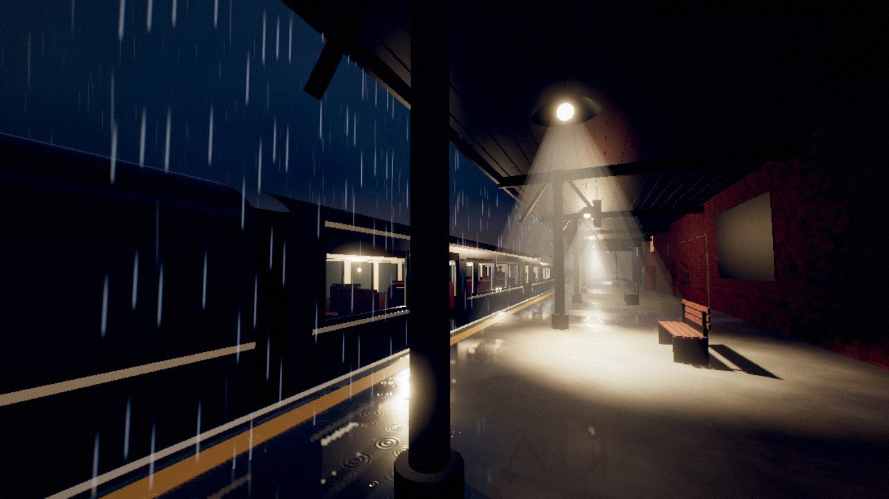
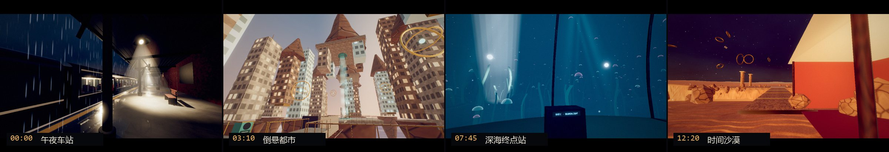

<sub><a href="../../README.md">← AIDIY</a> · <a href="../README.md">GAMES</a></sub>

# THE LAST TRAIN · 永不抵达的末班列车



午夜 00:00，你在暴雨中的零号站台醒来。一辆没有终点的列车停在站台上，你手里的车票，目的地一栏是空的。

一个在浏览器里运行的第一人称探索解谜游戏：六个世界，每个世界有自己的物理规则和真的要动手解开的谜题；一路上找到的东西、读过的档案、和列车长说过的话，决定三个结局里哪一个能够达成。

**[▶ 在线游玩](https://will1202.github.io/AIDIY/the-last-train/)** · 建议桌面版 Chrome / Edge，戴耳机。完整通关约 40–70 分钟。



## 运行

```bash
cd games/the-last-train
npm install
npm run dev        # http://localhost:5196
npm test           # 17 项自动测试（含六个世界的完整通关模拟）
npm run build      # 类型检查 + 生产构建，产物在 dist/
```

需要 Node.js 20.19+ 和支持 WebGL2 的浏览器。没有后端，不调用任何付费 API，离线也能完整游玩。

## 操作

| 按键 | 作用 |
|:--|:--|
| <kbd>W</kbd><kbd>A</kbd><kbd>S</kbd><kbd>D</kbd> / 方向键 | 移动（<kbd>Shift</kbd> 奔跑，<kbd>Space</kbd> 跳跃） |
| 鼠标 | 视角（点击画面锁定指针） |
| <kbd>E</kbd> | 检查 / 拾取 / 使用物品 / 放置 / 交谈 / 拉杆 / 坐下 |
| <kbd>Tab</kbd> / <kbd>I</kbd> | 背包（3D 物品预览、组合物品） |
| <kbd>J</kbd> · <kbd>M</kbd> | 任务日志 · 世界地图 |
| <kbd>H</kbd> | 提示（在一个步骤上停留越久，解锁的提示越具体） |
| <kbd>R</kbd>（按住）/ <kbd>F</kbd> | 时间沙漠：对准物体倒转时间 / 暂停·恢复 |
| <kbd>C</kbd> | 电影模式：隐藏 HUD、加电影黑边，适合录屏 |
| <kbd>P</kbd> | 拍照模式：时间暂停，自由移动镜头（不能穿墙）、调视野 / 曝光 / 倾斜，导出 PNG |
| <kbd>Esc</kbd> | 暂停菜单（继续 / 任务日志 / 背包 / 档案 / 收藏 / 地图 / 设置 / 重新开始本章 / 返回主菜单） |
| <kbd>F3</kbd> | 显示帧率 |

触屏：左半屏虚拟摇杆移动，右半屏拖动转视角，右下角交互 / 跳跃按钮，时间沙漠里会出现倒转 / 暂停按钮。

## 六个世界

| | 世界 | 核心机制 | 谜题 |
|:--|:--|:--|:--|
| 0 | **午夜车站** | 探索、检查、组合物品、输入密码 | 长椅上的车票 → 故障电子钟闪现的 23:59 + 售票窗口的告示 → 储物柜密码 → 检票钳 → 在背包里给自己检票 → 列车长放行 |
| 1 | **倒悬都市** | 重力翻转、绕桥轴旋转的桥段 | 桥段只有“桥面朝向你的脚”时才能走：下层要转到 0°，倒悬的上层要转到 180°；电池只有一块，取出后桥段锁死在原位，所以要想好顺序 |
| 2 | **深海终点站** | 修复电路、操纵探照灯、声呐对频 | 被淹的更衣室里找到保险丝 → 恢复主电路 → 拖动探照灯照亮三座声碑（才能看见目标波形）→ 声呐里把三组频率调准：看波形重合，或者听两个音之间的拍音慢下来直到消失 → 升降梯下到遗迹 |
| 3 | **时间沙漠** | 对物体倒转 / 暂停 / 恢复时间 | 倒下的钟塔就是桥 → 过桥后让钟塔倒转着站起来，并在它重新倒下前暂停 → 倒转塔里的升降台、站上去恢复时间 → 时间悖论：分针向前走、时针向后走，让两根同时停在 12 点 → 出塔、恢复钟塔时间让它再倒下成桥 |
| 4 | **记忆博物馆** | 视角决定结构、镜子 | 站进金圈朝正确方向看，散落的碎片拼成一幅画（错视）；走廊尽头的墙只有在你不看它的时候才会变成门；转动雕塑，让它投在墙上的影子拼出 00:00；三段记忆放回对应的基座；镜子里的人穿着列车长的制服，穿过镜子进入镜中世界 |
| 5 | **不存在的终点** | 由前面所有状态决定的结局 | 见下 |

**三个结局**由真实的游戏状态和三种不同的实际操作决定，而不是最后的三个按钮：

- **离开列车**：告诉列车长你想下车，他在你的车票上写下目的地；拿着这张票走出站台另一端的出站闸机。
- **成为新的列车长**：告诉列车长你会留下；进入驾驶室，戴上座位上的帽子，拉下发车杆。
- **打破时间循环**：需要时间沙漠钟塔上拆下的指针、镜中世界里的第一张车票、至少读过 4 份异常档案，并且告诉列车长你的决定；给站台大钟装上指针、把票放进钟柱上的票口，再把钟拨到 00:01。缺什么，钟会用剧情化的方式告诉你。

尾声文字还会根据一路上对列车长的信任 / 怀疑、是否知道真相、是否收集齐 6 张失落的车票而变化。结局之后可以继续游戏去达成其他结局；达成过的结局记录在「章节记录」里。

**支线与收藏**：5 份异常档案、6 张失落的车票（每个世界一张，藏在长椅下、倒悬的矮台上、水里、会被倒转的沙堆里、画框里……）、零号线广播的隐藏故事（售票室收音机调到 88.0）、倒写的字、鲸之歌、镜中字。

## 五个标志性时刻 / 展映模式

| 时刻 | 触发 |
|:--|:--|
| 雨夜列车 | 新游戏的开场：列车从暴雨和浓雾中驶来，车头灯照亮站台，减速、停稳、车门打开 |
| 世界倒转 | 第一次驶入倒悬都市：整座上城从云海下面绕到城市背后，再翻到头顶倒挂，天空的颜色随之倒转 |
| 深海鲸鱼 | 第一次驶入深海：车厢灯熄灭，一头巨鲸从车头方向贴着车窗游过，照亮航道旁的水母 |
| 时间冻结 | 拿起时砂怀表：沙粒、碎片和建筑部件从地面浮起，悬停在空中 |
| 终点反转 | 沿环形轨道驶入终点：之前的世界围着同一座车站出现，终点站就是零号站台 |

这些都是实时 3D 场景和游戏事件，不是视频。见过的时刻会在主菜单「展映模式」里解锁，可以单独回放用于录屏，回放不会改动存档。

## 技术方案

- **React 19 + TypeScript + Vite 8** 负责界面层；**three.js 0.187** 命令式渲染（没有用 React Three Fiber：游戏循环、资源释放、过场逐帧回放都需要精确控制，界面只订阅状态）。**Zustand** 管理游戏状态、设置和跨周目元数据。
- **渲染**：HDR 场景 → 双重滤波 Bloom → ACES 合成；统一调色、暗角、胶片颗粒、电影黑边、睁眼效果、时间冻结与水下效果都在一个合成着色器里完成。积水用斜近裁剪面的平面反射 + 雨点涟漪法线；雨丝、水花、水母、海带、沙粒、碎片全部实例化或在着色器里驱动；楼宇窗户、云海、天空、沙暴墙、体积光锥都是自定义着色器。
- **资源流式加载**：每个世界是独立的代码分包，列车关门出站时开始构建下一个世界，在隧道段里预编译着色器，驶入时完成切换；旧世界的几何、材质、纹理在离开时统一释放（共享的程序化纹理有缓存）。
- **碰撞**：自写的角色胶囊对盒体 / 圆柱 / 斜坡 / 高度场碰撞，所有竖直计算在“重力坐标”里完成，所以重力翻转后同一套代码照样能走；不依赖 WebGL，可以在 Node 里跑。
- **列车**：始终固定在场景原点，行驶时移动的是世界的根节点，所以玩家在行驶中也能在车厢里自由走动，进出车厢在空间上是连续的。
- **剧情**：对话图状态机（入口、台词、选项都可以依赖状态），选择会写入存档并影响后续台词与结局。全部原创文本，本地运行。
- **存档**：IndexedDB（不可用时退回 localStorage）。自动存档：交互后、到站时、切到后台、关闭页面前；每个章节到达时保存快照，用于「章节记录」与「重新开始本章」。
- **声音**：Web Audio 实时合成——雨（嘶声、雨滴颗粒、雨棚下变闷）、风、海、轮轨节奏（随车速）、刹车啸叫、汽笛和弦、车门、各种地面的脚步、机关、鲸歌、声呐、时间倒转、钟声、车站广播（共振峰合成的含混人声 + 字幕）、每个世界的配乐垫底。HRTF 空间定位。只在点击“开始旅程 / 继续游戏”后创建 AudioContext。
- **性能档位**：低 / 中 / 高 / 极高，调节渲染分辨率、MSAA、阴影、Bloom 级数、雨量、粒子数量、平面反射分辨率；按 GPU 名称给出初始档位（核显默认“中”）。

```
src/
  game/        游戏总控（循环、行驶状态机、交互检测、过场导演、展映）
  engine/      渲染管线、画质档位
  physics/     碰撞世界
  player/      输入、第一人称控制器
  world/       世界基类、列车、列车长、共享模块（雨、反射、天空、鲸……）与六个世界
  puzzles/     可单独测试的谜题逻辑（桥段、声呐、时间物体、博物馆）
  systems/     对话执行器、结局条件、UI 桥
  content/     物品、档案、任务、对话（全部原创文本）
  state/       游戏状态、存档、界面状态
  audio/       程序化声音引擎
  ui/          主菜单、HUD、暂停菜单、背包 3D 预览、对话、密码锁、收音机、声呐、拍照、结局
  test/        无渲染模拟器 + 自动测试
```

## 测试

`npm test` 运行 17 项测试。核心是一个**无渲染模拟器**：在 Node 里构建真实的世界（几何、碰撞、交互、谜题逻辑），用真实的角色控制器沿路点走路，一步步完成每个世界：

- 午夜车站：拾票、错误密码被拒、正确密码开柜、组合检票、列车长放行、走进车厢后自动发车。
- 倒悬都市：初始和错误朝向下桥确实走不过去，按正确顺序转桥、取电池、翻转重力、上层转到 180°、进塔取碎片、翻转回来、走回站台。
- 深海：没电时控制台不可用；拿保险丝、通电、照亮三座声碑、未照亮时声呐无法调准、调准后入口打开、升降梯上下、取碎片和档案。
- 时间沙漠：站在钟塔扫过的范围里被拒绝；倒转钟塔、松开后它继续倒下、及时暂停；倒转升降台、站上去恢复时间上到塔顶；分针和时针分别停在 12 点；下塔、恢复钟塔时间让它倒下成桥、走回去。
- 记忆博物馆：错视方向不对不触发、对了才触发；看着走廊尽头时墙不变、转身后变成门；拖动转台直到影子成字；基座组合；镜子揭示；穿过镜子取得第一张车票和碎片。
- 终点：没有满足条件时三个结局都不会发生、出站闸机确实挡路；三个结局分别由各自的状态和操作触发。
- 存档：IndexedDB 读写往返（用 fake-indexeddb）、旧存档迁移、重置。
- 规则单元测试：桥段朝向、声呐容差、时间物体的倒转 / 暂停 / 吸附、博物馆基座组合。

另外有五个在真实浏览器（本机 Chrome，ANGLE / D3D11 真实 GPU）里跑的脚本，需要本机装有 Chrome（或用 `CHROME_PATH` 指定）：

```bash
npm run bench        # 1080p 各场景帧率（中 / 高两档）+ 截图，结果在 .shots/bench/
npm run e2e          # 整条旅程：新游戏 → 车站 → 五次真实行驶 → 结局 → 刷新后继续，检查无报错、存档恢复
npm run e2e:scenes   # 三个结局过场与五段展映回放，按时间点截图
npm run e2e:audio    # 触发全部音效 / 环境声 / 配乐，检查无异常并测输出电平
npm run e2e:tour     # 美术巡检：按玩家视角在六个世界的关键位置逐张截图，结果在 .shots/tour/
```

这些脚本和开发时的手工检查都通过开发模式下的 `window.__LT` 测试钩子（手动步进、截图、瞬移、直接触发交互；生产构建里加 `?debug` 才会加载）。手工检查过：主菜单、开场过场、车站全部交互、对话放行、登车后真实发车 → 隧道 → 驶入倒悬都市并记录“世界倒转”时刻，以及六个世界的加载与画面。

## 素材与许可

- 全部模型、纹理（程序化噪声 / Canvas）和声音（Web Audio）都在运行时生成；项目里没有任何外部美术或音频文件。
- 剧情、对白、档案、关卡、谜题均为原创。
- 依赖：three.js（MIT）、React（MIT）、Zustand（MIT）、Vite（MIT）、Vitest（MIT）、fake-indexeddb（Apache-2.0，仅测试）。字体：Cormorant Garamond（SIL OFL 1.1）、Geist Mono（SIL OFL 1.1），由 @fontsource 打包进构建产物；中文使用系统字体。

## 性能（实测）

测量条件：本机 AMD Radeon 860M 核显，Chrome 157 无头模式（ANGLE / Direct3D 11，确认用的是真实 GPU），1920×1080、像素比 1，关闭垂直同步让帧率不封顶，每个场景玩家静止 4 秒取平均帧时间。脚本对生产构建运行。

| 场景 | 中（核显默认档） | 高 |
|:--|--:|--:|
| 主菜单（雨夜车站） | 110 | 141 |
| 午夜车站站台 | 122 | 85 |
| 列车车厢 | 113 | 77 |
| 倒悬都市 · 下城 / 上城 | 240 / 321 | 146 / 168 |
| 深海终点站穹顶 | 193 | 113 |
| 时间沙漠 | 252 | 154 |
| 记忆博物馆 | 231 | 107 |
| 不存在的终点 | 243 | 157 |

单位 FPS。“高”档的深海原来只有 47 FPS（穹顶与隧道的双面透明玻璃 + 贴近镜头的光柱整屏叠加），改成单面玻璃、光柱按距离淡出后到 120 FPS；车站把 90 个远景灯、31 盏墙灯、站台号牌、灯罩和 24 个车轮合并成实例化 / 合批绘制。帧率不封顶时帧间隔波动较大（GPU 队列排队造成），另外用 gl.finish() 逐帧同步测过车厢场景：游戏逻辑 + 提交渲染平均 3.9 ms、最慢 14 ms，没有超过 20 ms 的卡顿帧。实际游玩时浏览器按显示器刷新率同步。

2026-11-27 补场景细节之后（博物馆护墙板与吊灯、上下城广场陈设、沙漠石柱与石板、深海穹顶地面、终点站立面），把新旧两版构建交替各测两轮（中档）：两版之间的差异都落在同一台机器连续两次运行 ±30% 的波动以内（测量时后台有其他程序占用 CPU，整体帧率比上表低），没有测出可确认的退化。上表是此前安静环境下的测量；新增几何都是合批的静态网格，各场景绘制调用增加 0～11 个。

## 已知限制（如实列出）

- 美术是程序化的低多边形风格，不是 AAA 级的手工模型和贴图；博物馆、深海侧室、终点站立面等处补过细节，但仍是简单几何加程序化纹理。
- 没有真人配音：车站广播是合成的含混人声加字幕，列车长只有字幕。
- 声音在真实 Chrome 里检查过不报错、电平正常（RMS 约 −16 ～ −19 dBFS，无削波），但没有人工逐段试听过音色。
- 三个结局过场、五段展映回放已在真实 GPU 的无头浏览器里逐段截图检查；触屏操作没有在真实手机上试过。
- 没有从新游戏一路手动通关到结局的连续浏览器实测；各世界的通关路线是在 Node 模拟器里用真实碰撞验证的，浏览器里是逐个世界加载检查。
