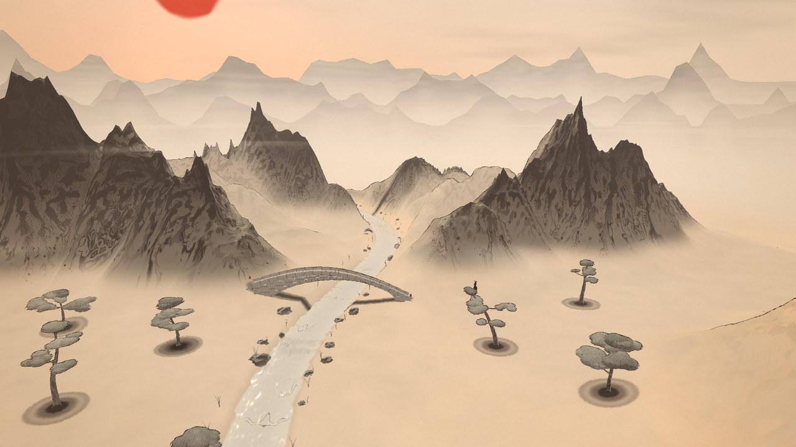

<sub><a href="../README.md">← AIDIY</a></sub>

# GENERATIVE ART · 生成艺术

由你的笔触生成的世界。画面不是预先做好的模型，而是根据你实际画下的每一笔，当场生成、当场渲染出来的。

<a href="inkverse"></a>

**INKVERSE · 一笔入江湖**：在宣纸上用毛笔画山、画河、点松、架桥，墨迹在纸上洇开，再从纸里长成三维山河；按下 AWAKEN，整张纸鼓成一个有天空、雾气和远山的水墨世界，最后可以变成小侠客走过自己画的桥。<br>
<sub>鼠标 / 手写笔绘画，键盘行走 · 按 <kbd>C</kbd> 播放 30 秒演示 · <code>localhost:5190</code> · <a href="https://will1202.github.io/AIDIY/inkverse/">▶ 在线体验</a></sub>

```bash
cd generative-art/<作品目录>
npm install
npm run dev
```
