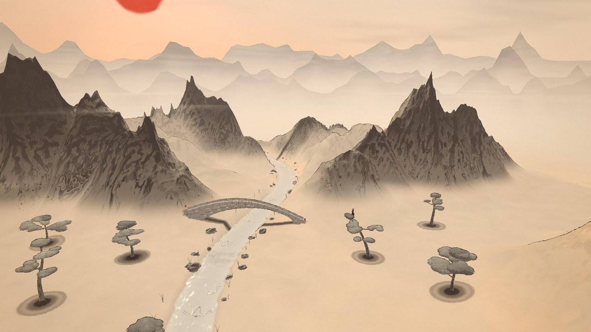
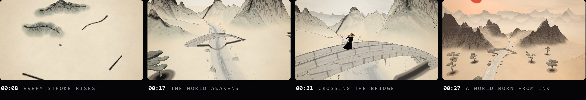

<sub><a href="../../README.md">← AIDIY</a></sub>



# INKVERSE — 一笔入江湖

**EVERY STROKE CREATES A WORLD.** 每一笔，都可以创造一个世界。

在浏览器里拿起一支毛笔，在宣纸上画山、画河、点松、架桥。墨迹会在纸上晕开，然后真的从纸里长成三维的山河；按下 **AWAKEN**，整张宣纸鼓起成一个有天空、雾气和远山的水墨世界，镜头从俯视的纸面一路推进去。最后你可以控制一个戴斗笠的小侠客，走上自己刚刚画出来的桥。

全部实时计算：墨水是 GPU 上的扩散模拟，山是由笔迹生成的高度场，没有预渲染视频，也没有现成的模型。



## 运行

```bash
cd generative-art/inkverse
npm install
npm run dev        # http://localhost:5190
npm run build      # tsc 类型检查 + 生产构建 → dist/
npm run preview    # 预览生产构建
```

需要支持 WebGL2 的桌面浏览器（推荐 Chrome / Edge）。地址后加 `?showcase` 跳过标题直接播放 30 秒演示（声音需要先点一下页面）；加 `?q=LOW|MEDIUM|HIGH|ULTRA` 指定画质；加 `?debug` 在生产构建里也打开测试接口 `window.__INK`。

## 怎么玩

1. 标题页点 **ENTER THE PAINTING**，进入绘画模式（DRAW）。
2. 右侧选画笔，在纸上画：
   - **山 MOUNTAIN**：画一道山脊线。线有多长、走向如何、哪里墨重，山就在哪里、有多长、主峰在哪。慢慢画墨更浓、山更高；快速划过是细而干的飞白。
   - **水 RIVER**：画一条蜿蜒的线，蓝灰色笔迹沿着你画的方向变成流动的河，河道切开地形（穿过山体会形成峡谷），两岸长出石头和芦苇。
   - **松 LIFE**：点一下落一滴墨，墨晕开后长出一棵松树；拖动可以一笔种一片林。每棵树的形态都不同。
   - **桥 BRIDGE**：在河两岸或两座山崖之间画一条线，墨线会变成一座可以走上去的桥（按地形自动选择石拱桥、木栈桥或吊桥）。画在平地上、两端落在水里、被山挡住或高差太大时，会给出提示，墨线被洗掉。
3. 按 **AWAKEN**：墨迹颤动，整个世界从纸面鼓起，相机从俯视转到透视并推进去，天空、远山、雾层随之出现。之后可以拖动环视。
4. 按 **EXPLORE**：变成小侠客，走进自己画的世界。
5. 右上角 **WEATHER** 切换黄昏、夜晚、雨、风；**QUALITY** 切换画质；**SOUND** 开关声音；**CINEMATIC** 播放 30 秒演示。

| 操作 | 按键 |
|---|---|
| 选择画笔 | 右侧画笔栏，或 `1` 山 `2` 水 `3` 松 `4` 桥 |
| 绘画 | 鼠标左键 / 触屏 / 手写笔（支持压感） |
| 环视世界（AWAKEN 之后） | 左键拖动旋转，右键或 `Shift` + 拖动平移，滚轮远近 |
| 行走 / 疾行 / 跳跃 | `W A S D` / `Shift` / `Space` |
| 调整视角（EXPLORE） | 鼠标拖动，滚轮调整距离 |
| 打坐 / 观景 | `E` / `Q`（再按一次起身；站着不动一会儿也会自己观景） |
| 退出行走 | `Esc` |
| 30 秒电影演示 | `C`（再按一次或 `Esc` 提前结束） |
| 隐藏界面（录屏） | `H` |

绘画、环视和行走是三个分开的模式：在 DRAW 里拖动只会画画，在世界里拖动只会转镜头，不会互相误触。

## 30 秒演示

| 时间 | 画面 |
|---|---|
| 0–4 s | 空白宣纸，毛笔进入画面，第一滴墨落下晕开 |
| 4–9 s | 毛笔快速画出五道山脊，山峰从纸面升起，镜头缓慢旋转 |
| 9–14 s | 画出河流，水沿笔迹流动；连点八滴墨，松树逐一长出 |
| 14–19 s | 在两岸之间画一条长线，石拱桥搭起；世界鼓起成三维，镜头推向桥 |
| 19–24 s | 侠客从远处跑来，真的从桥上跑过去，镜头侧面跟拍 |
| 24–30 s | 镜头拉高，黄昏的朱砂落日下展现整个世界，片尾字幕 |

演示用的是预设笔迹，但走的是和鼠标完全相同的管线：笔触 → 墨水模拟 → 世界生成 → 角色控制器。演示结束后世界保留下来，可以继续环视、行走或者再画。横屏和竖屏（9:16）都会自动调整构图。

## 系统结构

```
src/
  input/BrushInputSystem.ts      指针 / 手写笔 / 脚本笔迹 → 带惯性的笔尖 → 墨水印章 + 笔画事件
  ink/InkRenderer.ts             墨水物理（GPU）：笔触层 + 湿墨模拟层（MRT ping-pong）
  ink/paper.ts                   程序化宣纸纹理（纤维、施胶不匀、颗粒）
  world/World.ts                 StrokeInterpreter：笔画 → 生成指令；实体生长时间线；空间查询
  world/Heightfield.ts           统一高度场：山体平滑并集、河道下切，CPU 采样 + GPU 纹理
  world/TerrainGenerator.ts      山脊 → 山峰、山体、岩壁细节、淡墨远山（五个阶段）
  world/TerrainMesh.ts           地形网格与水墨地形着色（皴法、勾线、点苔、自阴影）
  world/RiverGenerator.ts        河道下切 + 流动水面（水纹、倒影、雨点涟漪）
  world/VegetationGenerator.ts   程序化松树（树干、枝条、松针团），顶点着色器生长 + 风
  world/BridgeGenerator.ts       架桥校验、三种桥型、"墨线 → 建筑"动画、桥面碰撞
  world/Decor.ts                 河岸石头与芦苇（Instancing）
  world/Backdrop.ts              纸外的留白地面与三层远山
  world/WorldTransition.ts       AWAKEN：2D → 3D 的连续过渡
  character/                     小侠客模型、程序化动画、角色控制器
  camera/CameraRig.ts            纸面取景 / 环视 / 跟随 / 脚本镜头，模式间平滑过渡
  weather/WeatherSystem.ts       昼、暮、夜、雨、风，全部连续过渡
  cinematic/CinematicDirector.ts 30 秒演示时间线与镜头
  render/Pipeline.ts             水墨 NPR 合成：勾线、远景淡化、雾层、天空、纸纹
  render/Reflection.ts           河面平面倒影
  audio/AudioEngine.ts           全部程序化合成的声音
  engine/Engine.ts               模式状态机、帧循环、输入路由、自动降画质
```

**统一的世界坐标**：宣纸就是三维世界的地面（240 × 240 单位）。笔迹记录的是世界坐标，墨水贴图覆盖同一块正方形，高度场也覆盖同一块正方形，所以纸上的一笔和从它长出来的山永远在同一个位置。AWAKEN 时什么都不替换，只是把同一个世界的竖直比例从 0.42 鼓到 1，同时移动相机、打开大气。

**墨水物理**：每一笔被拆成沿路径排列的笔刷印章，印章里按"横向坐标 + 沿笔画弧长"计算刷毛条纹，所以干笔飞白的丝缕沿着笔势连续。速度、停留时间和剩余墨量决定宽度、墨量、含水量和干湿：快 → 细而干，慢 → 浓墨积水，停住 → 墨在纸上持续洇开。湿墨层每帧在 GPU 上模拟：水沿宣纸纤维各向异性地渗开，颜料随水流迁移，干燥前沿蒸发更快，把颜料拉到边缘形成水痕，最后沉积进纸里；叠加的笔画会越叠越深。下雨时纸面会重新被打湿，已经干了的墨会轻微再晕开。

**山体生成**：平滑后的笔迹就是山脊。长度决定整体规模，墨重（慢画、停顿、手写笔压力）决定主峰位置和高度，山峰沿着你画的路径分布。山体先作为平滑的山形升起，随后长出岩壁、沟壑和断层带，最后在背后生成一道淡墨远山。多座山用平滑并集合并，河道在山之后下切。

## 已验证

以下在本机（AMD Radeon 860M，Chrome，WebGL2）实际运行检查过：

- 类型检查与生产构建通过（`npm run build`）。
- 真实的 `PointerEvent` 绘画：画出的山脊起点与屏幕拾取点误差在 0.1 单位内；横屏 1280×720 与竖屏 540×960 切换后坐标映射仍然正确。
- 四种画笔都能生成对应结构：不同长度的山脉、连续多次绘画、河流沿笔迹生成并切穿山体、松树生长、三种桥型中的石拱桥实测。
- 非法架桥（平地上画桥）会提示"此处平地，无需架桥"，墨线被洗掉；在河里点墨种树会提示并拒绝。
- 30 秒演示完整跑完：5 座山、1 条河、8 棵松、1 座跨度约 31 的石拱桥；侠客在桥面上实际走过约 31 个单位并到达对岸，结束后进入可环视的世界。
- EXPLORE：按 `W` 走上拱桥，高度随桥面拱起（约 4.8 → 7.1 → 4.9），松开按键后停下；奔跑、跳跃、打坐、观景姿态都会切换。
- 反复切换 DRAW → AWAKEN → EXPLORE → DRAW 三轮，几何体与纹理数量不增长；RESET 后生成的几何体被释放。
- 画质切换时纸上已有的墨迹会保留下来；黄昏、夜晚、雨、风都能平滑切换。
- GPU 吞吐（完整演示场景，1280×720，含倒影与自阴影）：LOW 约 1.7 ms/帧，HIGH 约 3.5 ms/帧，ULTRA 约 3.7 ms/帧。

## 已知限制 / 未完成

- 自由绘画识别没有做：现在是四种明确的语义画笔，"画什么、生成什么"由画笔决定。用图形识别或多模态模型识别任意涂鸦留到以后。
- 山体陡坡（大于约 51°）走不上去，侠客可以在山脚、谷地、河岸和桥上行走；深水挡路，不能游泳。
- 桥建成后是固定的：之后再在桥下画山或画河，桥不会重新计算。
- 角色只和树干、桥栏、陡坡、深水发生碰撞，不和石头、芦苇碰撞；视角是拖动鼠标，不锁定指针。
- 触屏可以画画和环视，但 EXPLORE 还没有屏幕摇杆。
- 声音全部是程序化合成的，代码在运行中不报错，但我这边没法用耳朵确认听感，需要你开声音试一下。
- 上面的测试都是在隐藏的浏览器面板里用脚本驱动的（包括合成的鼠标事件）；可见窗口里实际的帧率、手感还需要你亲自体验确认。
- 马善政书法字体按 unicode-range 切片打包，构建目录约 9 MB，但浏览器只会下载页面用到的几片。
