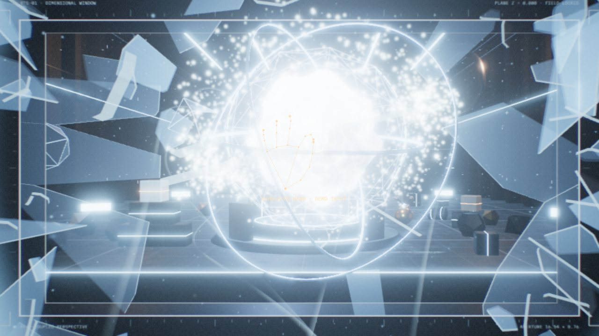

<sub><a href="../README.md">← AIDIY</a></sub>

# MIXED REALITY · 体感与混合现实

用摄像头、头部追踪和手势，把现实和屏幕里的世界连起来的作品。识别全部在本机浏览器中完成，画面不会上传；没有摄像头时，也可以用鼠标完整体验。

<a href="break-the-screen"></a>

**BREAK THE SCREEN**：屏幕变成一扇通往实验室的窗。头一动，透视就跟着变；伸手抓住能量核心把它拉出来，屏幕玻璃被顶裂、碎掉，整个实验室从窗口冲出，再一拍手全部复原。<br>
<sub>摄像头手势 + 头部追踪 / 鼠标键盘 · 按 <kbd>D</kbd> 播放 30 秒演示 · <code>localhost:5187</code> · <a href="https://will1202.github.io/AIDIY/break-the-screen/">▶ 在线体验</a></sub>

```bash
cd mixed-reality/<作品目录>
npm install
npm run dev
```
