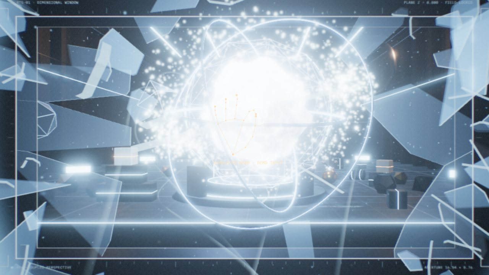

<sub><a href="../../README.md">← AIDIY</a></sub>



# BREAK THE SCREEN — REALITY HAS NO BOUNDARIES

> 如果你的屏幕是一扇通往另一个维度的窗户呢？

一个跑在浏览器里的混合现实交互作品。打开摄像头后，网页会实时追踪你的**头**和**手**：

- 你左右、上下移动头，屏幕里的三维实验室会按你眼睛的真实位置改变透视（真正的视点相关投影，不是旋转场景）；
- 你对着摄像头捏合手指，就能抓住里面的能量核心、金属球、立方体，拖动、抛出去，它们有真实的物理碰撞；
- 把能量核心往自己这边拉，它会顶在"屏幕玻璃"上，玻璃先出现裂纹、鼓起，然后整块碎掉，碎片和整个实验室的东西从窗口里冲出来；
- 拍手（或按 `R`）一切重新飞回原位，可以无限次重来。

没有摄像头也能完整体验：鼠标拖拽 = 捏合抓取，滚轮 = 拉近 / 推远，右键 = 能量冲击，`Alt` + 移动鼠标或方向键 = 模拟头部移动。

还有一段**30 秒电影级自动演示**（`WATCH DEMO` 或按 `D`），完全由实时的引擎、物理和碎裂系统演出，不是预渲染视频，可以直接录抖音。

---

## 运行

```bash
cd mixed-reality/break-the-screen
npm install
npm run dev        # http://localhost:5187
```

- 摄像头只能在 `localhost` 或 HTTPS 下打开（浏览器限制）。
- 第一次点 START CAMERA 时，会从 Google 的公开模型仓库下载人脸 + 手部模型（约 11 MB，之后浏览器会缓存）。MediaPipe 的 WASM 运行时由本站自己提供，不依赖 CDN。
- 推荐桌面版 Chrome / Edge（需要 WebGL2）。

其他命令：`npm run build`（类型检查 + 生产构建）、`npm run preview`、`npm test`（21 个单元测试）、`npm run typecheck`。

---

## 怎么玩

### 用摄像头（手势 + 头部）

| 动作 | 效果 |
|---|---|
| 移动头 | 透视随眼睛位置变化：头往左，能看到原本被挡住的右侧空间；凑近屏幕，视野变宽 |
| 捏合（拇指 + 食指） | 抓住手指所指的物体 |
| 捏住移动 | 拖动，物体有重量感和滞后 |
| 捏住时手往后拉（离屏幕更远） | 把物体从屏幕里拉出来；往前推 = 推回深处 |
| 快速甩手后松开 | 按手的速度抛出物体 |
| 张开手掌停住约 0.5 秒 | 能量冲击波，推开周围物体（离玻璃近时会震裂玻璃） |
| 张开手快速上 / 下 / 左 / 右挥 | 重力反转 / 恢复 / 向左 / 向右 |
| 两只手捏住同一个物体 | 拉开 = 放大，合拢 = 缩小，转动两手连线 = 旋转，一只手前后错开 = 绕竖轴转 |
| 两只手同时在空处捏合 | 在两手之间"创造"当前模式的物体（星球 / 液态金属 / 粒子星系 / 机械立方体） |
| 双手张开后合拢（拍手） | REBUILD，世界复原 |

### 用鼠标 / 键盘

| 按键 | 效果 |
|---|---|
| 左键按住拖动 | 抓取、拖动、甩出 |
| 滚轮（抓着东西时） | 往下滚 = 拉出屏幕，往上滚 = 推回去；`Shift` + 滚轮 = 缩放 |
| `Q` / `E`（抓着时） | 旋转 |
| 右键 / `Space` | 能量冲击 |
| `Alt` + 移动鼠标、方向键、`PageUp/PageDown` | 模拟头部移动（`0` 复位） |
| `G` | 重力循环：NORMAL → ZERO → REVERSE → SIDEWAYS（再按 SIDEWAYS 换方向）；`Z` 直接零重力 |
| `B` | 在鼠标位置击碎玻璃 |
| `R` | REBUILD |
| `C` / `1`–`4` | 创造物体 / 切换模式 |
| `D` | 30 秒电影演示（`Esc` 退出） |
| `H` | 隐藏 / 显示界面（录屏用） |
| `F` | 全屏 |
| `M` | 静音 |

右侧面板还有 QUALITY（LOW / MED / HIGH / ULTRA）、CAMERA、RECALIBRATE、VIEW（FULL / 16:9 / 9:16 画框）。

### 校准

单目摄像头不知道你的屏幕多大、眼睛离屏幕多远，所以 RECALIBRATE 面板里可以设置：

- **视差强度**：100% 是按你填的数值几何上精确的窗口效果；觉得晕就调低，录视频可以调高。
- **观看距离**、**屏幕宽度**（厘米）。
- **CAPTURE REST POSE**：坐在平时的位置、看屏幕中心，记录"静止姿态"。之后的头部移动都相对这个姿态计算。开摄像头后稳定追踪约 0.6 秒会自动校准一次。
- 如果你的摄像头本身输出的是镜像画面（少数设备），勾选 MIRRORED WEBCAM。

---

## 它是怎么做到的

### 1. 头部追踪 → 非对称透视（Off-Axis Projection）

把真实的屏幕当成场景里的一扇窗：屏幕是 `z = 0` 平面，窗里的世界在 `z < 0`，冲出来的东西在 `z > 0`。眼睛是这扇窗前的相机。

- 每帧根据眼睛在屏幕坐标系里的位置 `(ex, ey, ez)`，算出以屏幕矩形为底的**非对称视锥**（Kooima 的广义透视投影，`src/camera/HeadTrackedCamera.ts`）。相机永远朝 `-z`，只有视锥歪斜。所以屏幕平面上的点永远不动（零视差），窗后的东西随头同向移动、越远移动越多，窗前的东西反向移动。这就是真实的运动视差。
- 头的位置来自 MediaPipe Face Landmarker：取两眼眼角的中点；用"人的瞳距平均 6.3 cm"当尺子，把像素换算成厘米；距离用瞳距的像素大小相对校准时的比例来估计（`src/tracking/HeadTracker.ts`）。**这是单目估计，不是测距**。
- 摄像头画面是未镜像的：你往自己左边移，脸在画面里往右走，所以 x 取反（有单元测试）。
- One Euro 滤波去抖；多人入镜时锁定主用户（就近匹配，跳变过大的脸不跟）；追踪丢失后先保持 0.3 秒，再平滑回到静止视角；重新捕获时平滑淡入；眼睛移动速度有上限，任何误检都不会让画面瞬移（`src/camera/Viewer.ts`）。

### 2. 手 → 射线 → 深度 → 物理弹簧

`摄像头帧 → 手部关键点 → 屏幕上的点 → 从眼睛出发的拾取射线 → 目标深度 → 弹簧目标点`

- 捏合点（拇指尖和食指尖中点）镜像后映射到屏幕，再从**头部追踪的眼睛**穿过这个屏幕点打出射线。所以你看到的手指位置和抓到的物体是一致的。
- 深度不用不可靠的单目手部 z 值，而是用**手掌在画面里的大小**：手往后拉（离摄像头远）手掌变小 → 物体朝你移动。
- 抓取不是让物体瞬移到手上：物体保持动态刚体，每个 120 Hz 物理步给它一个速度弹簧，所以有重量感、有滞后、会推开别的物体、会被墙挡住。松手时用最近 0.11 秒手的速度给出抛出速度和自旋。
- 手势状态机：`IDLE → HOVERING → PINCH_STARTED → GRABBING ⇄ DRAGGING → RELEASING → GESTURE_COOLDOWN`，捏合有滞回阈值 + 连续帧确认；手离开画面 0.45 秒内仍保持抓取，之后轻轻放下。

### 3. 打破屏幕

- 屏幕边框是一块真实的、有洞的墙（也是物理碰撞体），带一段可以看进去的窗洞内壁。窗里的东西只能透过洞看到，是普通的深度测试；冲出来到 `z > 0` 的东西离你更近，自然画在边框前面。
- 玻璃是一个可以开关的碰撞体。核心被拉向你时会顶在玻璃上；手"拉"得越用力，玻璃受到的压力越大：玻璃鼓起、裂纹从接触点按蜘蛛网形状扩散（程序化 Voronoi，`src/screen/voronoi.ts`），边框灯从冷色变暖、闪烁；扔东西砸玻璃、在玻璃附近放冲击波也会造成损伤。
- 损伤到 100% 时，裂纹划出的每一块 Voronoi 单元都变成一块真实的凸包刚体玻璃碎片（`src/screen/FractureSystem.ts`），放在它在玻璃里原本的位置，所以碎裂正好沿着你刚才看着蔓延的裂纹。部分边缘碎片会卡在框里一会儿再掉下来。少数碎片会直接朝镜头飞过去。
- REALITY OVERFLOW：几千条光迹、几百个金属碎块沿着"从大厅深处 → 窗洞内某点 → 你身后"的直线冲出来（保证永远穿过窗洞而不是穿过墙），再加几十个真实刚体（小星球、机械环、几何体）、能量流、径向模糊和镜头震动。
- REBUILD：先是一个向中心的引力场把所有东西吸拢，然后每一块碎片、每一个物体沿平滑曲线飞回原位（运动学刚体），全部到位后玻璃复原、裂纹从冲击点向外愈合。可以反复执行。

### 4. 重力

`NORMAL / ZERO / REVERSE / SIDEWAYS` 直接改 Rapier 世界重力。被抓着的物体重力为 0，不受影响；所有刚体有速度上限；房间和屏幕前方都有封闭的碰撞空间，不会无限加速。零重力时贴着地面的东西会被轻轻托起漂浮。

### 5. 创造模式

| 模式 | 视觉 | 交互 |
|---|---|---|
| PLANET | 程序化地表（海洋、大陆、雪顶）、旋转云层、大气辉光、粒子轨道环 | 双手拉开放大；压缩到出生尺寸一半以下会能量爆发 |
| LIQUID METAL | 噪声驱动的流动镜面金属，顶点着色器里实时重算法线 | 手经过 / 抓着时表面产生涟漪，冲击波会扰动它 |
| PARTICLE GALAXY | 最多 8 万粒子的旋臂星系，差速旋转 | 双手控制大小和旋转；双手快速甩开松手 = 粒子炸散 |
| PHYSICS CUBE | 12 根框架梁、角块、发光面板、旋转内核的重型机械立方体 | 抓取、抛掷、碰撞 |

### 6. 30 秒电影演示

`src/cinematic/CinematicDirector.ts` 只做一件事：给引擎喂**模拟输入**——一条预设的头部轨迹和一只程序化的手（画面上明确标注 `SIMULATED HAND · DEMO INPUT`，顶部也有 `SIMULATED HEAD + HAND INPUT` 标签）。抓取、拉出、顶裂玻璃、碎裂、溢出、重力反转、旋涡、复原，全部走和真人操作完全相同的代码路径。只有一个保底：如果 13.95 秒时玻璃还没被拉碎，导演会在核心位置把它打碎，保证节奏卡点。

| 时间 | 段落 |
|---|---|
| 0–4 s | THE IMPOSSIBLE WINDOW：头部左右摆动展示视差 |
| 4–9 s | THE FIRST TOUCH：模拟手靠近、捏住核心 |
| 9–14 s | PULLING REALITY：把核心拉向镜头，顶在玻璃上，裂纹蔓延 |
| 14–20 s | BREAK THE SCREEN：碎裂、爆发、实验室涌出屏幕 |
| 20–25 s | GRAVITY COLLAPSE：重力反转，碎片围绕核心旋转 |
| 25–30 s | REBUILD：一切飞回，标题 BREAK THE SCREEN / REALITY HAS NO BOUNDARIES. |

---

## 架构

React 只负责界面（`src/ui`），所有高频逻辑在原生 Three.js 引擎里，不走 React 状态。

```
src/
├── engine/Engine.ts            每帧调度：输入 → 眼睛 → 交互 → 物理 → 玻璃 / 碎裂 / 溢出 → 渲染
├── engine/Quality.ts           LOW/MED/HIGH/ULTRA 预设 + 动态分辨率（PerformanceManager）
├── camera/HeadTrackedCamera.ts 非对称投影
├── camera/Viewer.ts            真实厘米 ↔ 世界单位、视差强度、丢失时平滑回位
├── tracking/TrackingEngine.ts  摄像头生命周期、Worker 调度、背压（每帧最多分析一次）
├── tracking/vision.worker.ts   MediaPipe 在 Worker 里跑（失败时自动回退主线程）
├── tracking/HeadTracker.ts     头部测量、主用户锁定、校准、One Euro
├── tracking/GestureEngine.ts   捏合 / 张掌 / 挥手 / 拍手、双手槽位匹配
├── interaction/SpatialInteraction.ts  射线拾取、状态机、弹簧抓取、抛掷、双手缩放旋转、双手创造
├── interaction/MouseInput.ts   鼠标 / 键盘 / 触屏的同一套指针接口
├── physics/PhysicsEngine.ts    Rapier：房间、带洞的屏幕墙、玻璃、屏幕前的接收空间、爆炸、重力
├── physics/Homing.ts           REBUILD 的回位曲线
├── screen/ScreenBoundary.ts    边框、窗洞内壁、印刷刻度、玻璃着色器、裂纹贴图
├── screen/voronoi.ts           蜘蛛网式 Voronoi 裂纹
├── screen/FractureSystem.ts    玻璃碎片刚体
├── world/Lab.ts                实验室建筑、环形门、星球、晶格、体积光、灯光、环境贴图
├── world/EnergyCore.ts         能量核心（等离子着色器、陀螺环、晶格笼、粒子光环、点光源、拖尾）
├── world/ObjectFactory.ts      实验物体（金属球、立方体、多面体、机械结构）
├── world/Creations.ts          四种创造模式
├── fx/                          后期（HDR 钳制 + Bloom + 色差 / 径向模糊 / 暗角 / 颗粒）、冲击波、溢出、灰尘、准星、手部投影
├── cinematic/CinematicDirector.ts  30 秒演示
├── audio/AudioEngine.ts        Web Audio 实时合成的全部音效（无采样、无版权音乐）
└── dev/harness.ts              测试钩子（开发模式或 ?debug）
```

### 性能

- 物理固定 120 Hz 步长 + 渲染插值；手部 / 人脸推理在 Worker 里跑，主线程每帧只发送一张 ImageBitmap，上一帧结果没回来就不发新的（不会排队，同一帧不会分析两次）。
- 帧时间超过约 21 ms 持续 1.2 秒会自动降低渲染分辨率（最低 60%），有余量时再慢慢恢复。
- QUALITY 真实影响：像素比、MSAA、Bloom、阴影贴图尺寸、灰尘粒子数、实验物体数、玻璃碎片数、溢出光迹 / 碎块 / 刚体数量、星系粒子数、液态金属网格精度、径向模糊采样数。
- 测试环境实测（1280×720 视口，GPU 同步计时）：LOW 3.6 ms / MED 4.4 ms / HIGH 11.6 ms / ULTRA（1.5× 像素比）约 30 ms；碎裂后每档多 1–4 ms；物理一步约 1 ms。不同电脑会不一样，集显建议 MED 或 HIGH。
- 切换标签页、窗口大小改变、高 DPR 都处理了；WebGL 上下文丢失后会自动刷新页面。

### 隐私

- 只有点了 START CAMERA 才会请求摄像头。
- 视频帧只在本机浏览器（Worker）里分析，只保留关键点坐标，不保存、不上传任何画面或人脸数据。
- STOP CAMERA 会停止所有 MediaStreamTrack、释放模型和 Worker。
- 只有校准设置（屏幕宽度、观看距离等）存在 localStorage 里。

---

## 测过什么、没测过什么

**已实际验证**（开发服务器 + 内置浏览器，测试钩子 `window.__BTS`，截图保存在 `.shots/`，这个目录不进仓库）：

1. 头往左：眼睛 x = −7.6 cm，远处的环形门在画面里向左移 0.37（NDC），核心只移 0.14，屏幕平面上的点完全不动，屏幕前的点反向移动。头往右方向相反，没有镜像错误。凑近：眼距 60 → 43 cm，视野变宽。（输入是**合成的人脸关键点**，走完整的 HeadTracker → 滤波 → 投影流程。）
2. 捏合抓取：HOVERING → PINCH_STARTED → DRAGGING，抓取瞬间物体位移 0.014 单位（没有跳）。
3. 抛掷：甩手松开后核心获得 −21 单位/秒的速度沿甩手方向飞出。
4. 手离开画面：0.2 秒时仍在 GRABBING，0.7 秒时已轻放并进入冷却。
5. 拉出屏幕：核心被玻璃挡在 z = −1.17，压力使损伤上升，约 2 秒后碎裂，110 块碎片，核心冲到 z = +12。
6. STOP CAMERA：用合成视频流启动，Worker + GPU 推理约 30 fps（单帧 15 ms，主线程每帧约 2.3 ms），停止后 track 状态为 `ended`。生产构建也验证过。
7. 纯鼠标：真实的 pointer / wheel 事件抓住核心，滚轮 22 格后玻璃碎裂。
8. 碎裂 + 复原连续做两轮，每轮约 3.2 秒，玻璃碰撞体恢复、碎片和溢出物体清空、重力恢复、核心回家。
9. 重力反转时被抓着的物体 y 只变化 0.05，其它物体上天花板（平均 y = 10.3）；侧向重力平均 x = −9.9；速度上限生效。
10. 16:9 ↔ 9:16：视锥始终精确对应画布（屏幕角 → NDC (1,1)），窗洞重新布局，手指指向核心仍能命中。
11. 30 秒演示完整播放，玻璃在 13.95 s 碎裂，结束时世界恢复完好，可重复播放。
12. 四种创造模式：双手创造、缩放（1.7 → 2.9 倍）、旋转、星球压爆、星系甩散、立方体落地。
13. `npm test`：21 个单元测试（投影几何、视差方向、镜像、校准、主用户锁定、丢失回位、捏合滞回、张掌冲击、双手槽位、Voronoi）。

**没有验证 / 没有做**：

- **没有用真实摄像头测过**：开发环境里没有摄像头，所以真人的人脸、手部识别效果、手势阈值是否合适、真实环境下的抖动和延迟都还没验证。请第一次用时先打开 RECALIBRATE 面板调整。
- **真实的手挡住虚拟物体（像素级遮挡）没有做**：手部关键点不足以做高质量遮挡，需要人手分割模型；按需求把它留作增强项，没有用粗糙的多边形蒙版代替。
- 单目深度是估计值（靠瞳距像素大小和校准），不是真实测距；头部姿态（yaw/pitch/roll）只用于显示，不参与投影。
- 视差效果对**一只眼睛**（双眼中点）是几何正确的；用手机拍屏幕录视频时，效果对拍摄镜头位置不一定正确。
- 只在 Chromium 内核浏览器里测过，没有测 Safari / Firefox / 手机。

---

## 录屏建议

- 按 `H` 隐藏界面，`F` 全屏；竖屏视频在 VIEW 里切 9:16 画框。
- 想要稳定可复现的镜头就用 `D` 的 30 秒演示（自带章节字幕和结尾标题）。
- 真人出镜的玩法：手机架在你身后拍屏幕，视差强度调到 120–150%，效果更明显。
- 演示里第一下拉玻璃时声音会炸，先确认音量。
