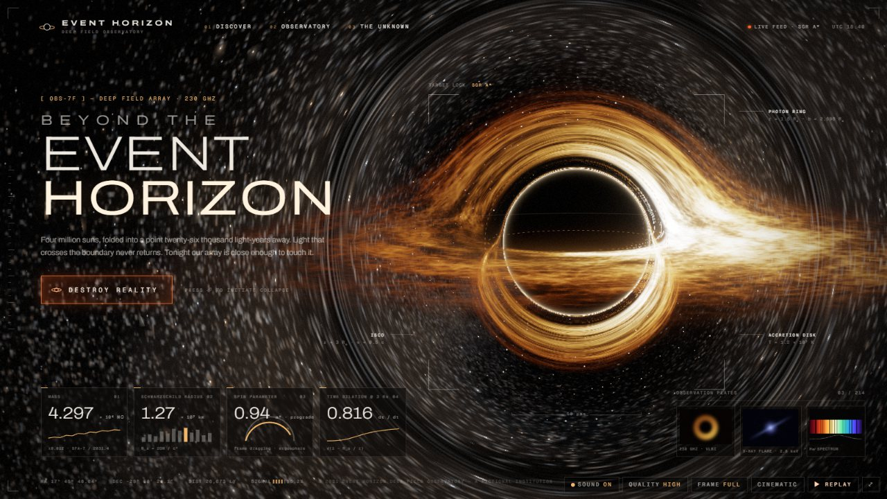
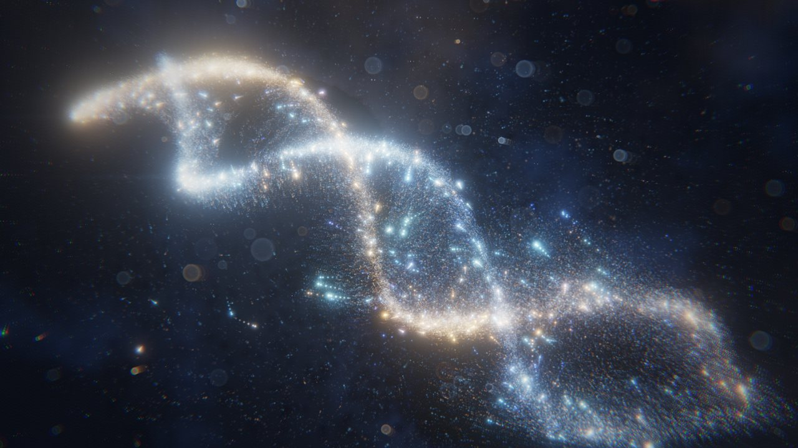

<sub><a href="../README.md">← AIDIY</a></sub>

# SPACE · 宇宙与物理

以宇宙、引力和天体物理为题材的作品。画面里的物理尽量是真正算出来的：光线积分、引力势、GPU 粒子模拟。做了艺术近似的地方，会在各自的 README 里写明。

<table>
<tr>
<td width="50%" valign="top">
<a href="event-horizon"></a>
<b>EVENT HORIZON</b><br>
一个会把自己所在网页吞掉的黑洞。DOM 元素被潮汐撕裂、坠入吸积盘，镜头穿过视界，进入另一个宇宙。<br>
<sub>鼠标 / 键盘 · 按 <kbd>D</kbd> 播放 30 秒演示 · <code>localhost:5181</code></sub>
</td>
<td width="50%" valign="top">
<a href="god-mode"></a>
<b>GOD MODE</b><br>
最多 26 万颗粒子的 GPU 宇宙。用手势让它旋转、坍缩成黑洞、引爆，再变成 DNA、星云和奇点。<br>
<sub>鼠标 / 触屏 / 摄像头手势 · 按 <kbd>R</kbd> 从大爆炸重播 · <code>localhost:5173</code></sub>
</td>
</tr>
</table>

```bash
cd space/<作品目录>
npm install
npm run dev
```
