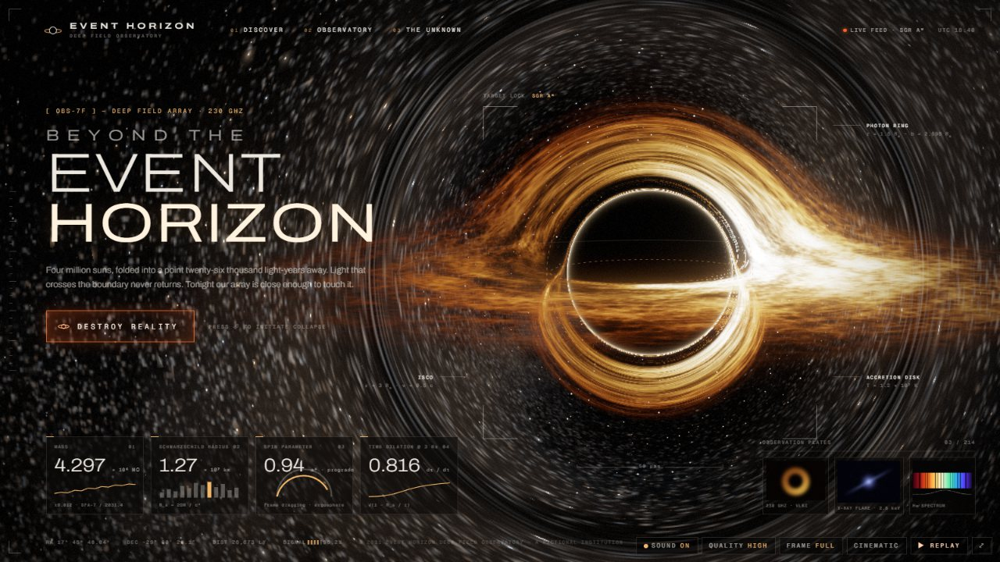

<sub><a href="../../README.md">← AIDIY</a></sub>



# EVENT HORIZON — WHAT IF A BLACK HOLE COULD CONSUME THE INTERNET?

一个会把自己所在的网页吞掉的黑洞。打开时是一个精致的未来主义"深空观测站"网站;点击 **DESTROY REALITY**,真实的 DOM 元素会被引力拉扯、潮汐撕裂、螺旋坠入吸积盘;随后镜头冲过事件视界,穿过时空隧道,进入另一个宇宙。整段约 26 秒,可反复重建与重播。

## 运行

```bash
cd space/event-horizon
npm install
npm run dev        # http://localhost:5181
npm run build      # tsc 类型检查 + 生产构建 → dist/
npm run preview    # 预览生产构建
```

需要支持 WebGL2 的现代浏览器(推荐 Chrome / Edge 桌面版)。没有 WebGL2 时会自动降级为纯 DOM 版本(CSS 黑洞 + DOM 引力动画)。

## 交互

| 操作 | 按钮 | 快捷键 |
|---|---|---|
| 摧毁现实(播放完整电影序列) | DESTROY REALITY | `Space` / `Enter` |
| 重建现实(从平行宇宙回到网页) | REBUILD REALITY | `R`(或 `Space`) |
| 一键演示回放(重置 → 3 秒静止 → 自动摧毁) | ▶ REPLAY | `D` |
| 电影模式(隐藏控制栏与鼠标,专用于录屏) | CINEMATIC | `C` / `Esc` 退出 |
| 声音开关 | SOUND | `M` |
| 画质 AUTO / LOW / MED / HIGH / ULTRA | QUALITY | `Q` |
| 录屏画框 全屏 / 16:9 / 9:16 | FRAME | `A` |
| 全屏 | ⤢ | `F` |

鼠标移动会让镜头轻微视差,并在吸积盘上牵引一团"磁流耀斑"(仅静止状态)。

## 录制 30 秒抖音视频的建议

1. 用 Chrome 打开,按 `F` 全屏,`Q` 切到 HIGH(独显可试 ULTRA),按 `C` 进入电影模式。
2. OBS 设为 60 fps 开始录制,然后按 `D`:3 秒静止的黑洞首屏 → 自动点击 → 约 26 秒完整吞噬与穿越,总长约 29 秒,正好卡 30 秒。
3. **竖屏 9:16**:把浏览器窗口调成竖长,或按 `A` 切到 `9:16` 画框后在 OBS 里裁切该区域。竖屏是单独设计的构图(黑洞在上三分之一,标题与按钮在下方,镜头更广),不是简单裁切。
4. 节奏对照:0–3s 黑洞首屏 → 3–6s 引力激活(冲击波、页面震颤倾斜)→ 6–11s 潮汐拉伸、元素脱离 → 11–15s 吸积高潮 + 吞噬后短暂寂静 → 16–20s 镜头推进并骤然加速穿越视界 → 20–24s 时空隧道 → 24–29s 平行宇宙与最终字幕。最后一帧(星环 + 星辰 + 字幕)适合作封面截图。

## 实现说明(哪些是物理,哪些是艺术近似)

**黑洞(`src/gl/shaders/blackhole.frag`)**
- 每个像素的光线用 Schwarzschild 度规下的光子轨道方程(Binet 形式 `x'' = -3/2·h²·x/r⁵`,r_s = 1)做 RK4 数值积分。阴影大小、光子环、远侧吸积盘被弯到黑洞上方和下方的弧、背景星空的引力透镜,全部来自这个积分,不是贴图。
- **非对称亮度**:吸积盘有相对论多普勒效应(亮度按 D⁴,颜色温度按 D 偏移)和引力红移。迎着镜头运动的一侧发白、发蓝、很亮,远离的一侧暗红,差距很明显。温度剖面近似 Shakura–Sunyaev。
- **空间结构**:从内到外依次是:ISCO(3 r_s)以内的螺旋坠落流;最亮的内缘;带暗缝的湍流丝状结构;缓慢旋转的双臂螺旋密度波;几个按各自开普勒角速度绕转的热斑(让差速旋转一眼可见);盘面上下有带湍流的发光气层,表现厚度。
- 每条光线会记录它在穿过黑洞所在平面之前遇到的近侧盘的不透明度,用来让落到黑洞背后的碎片被近侧吸积盘正确遮挡。
- **艺术近似**:盘本身是薄平面加一层发光气层;湍流是按开普勒角速度平流的噪声(双层交叉淡化,长时间运行也不会无限剪切);亮度曲线经过调校。这是非自旋黑洞,UI 卡片里的"spin 0.94"只是虚构的观测站文案。

**网页被吞噬(`src/systems/GravityEngine.ts`)**
1. **激活**:真实 DOM 元素通过 CSS `matrix()` 发生位移、倾斜、拉伸、震颤,强度按到黑洞投影位置的距离衰减(近强远弱)。标题、导航、段落在渲染时就拆成了逐字/逐词的 span,所以文字行会"弯曲"。
2. **脱离**:元素按距离由近到远依次进入以黑洞为原点的 3D 引力场,此时仍然是真实 DOM。
   - 引力用 Paczyński–Wiita 伪牛顿势 Φ = −GM/(r − r_s)。它能复现 3 r_s 处的最内稳定圆轨道,以及 ISCO 以内的坠落,这是牛顿引力做不到的。
   - 吸积流是次开普勒的:物质要绕好几圈才慢慢螺旋下降,越靠里转得越快。
   - 不同质量与吸积流的耦合不同,重卡片和轻字母走的路径不一样。
   - 潮汐应变按 ∝ 1/r³ 的梯度**持续累积、不会回弹**,所以元素沿指向黑洞的方向越来越长、横向越来越窄,同时自转逐渐加快。
3. **撕裂**:在同一帧、用完全相同的变换,把元素交给 WebGL。碎片取自点击瞬间的整页快照(html-to-image,字体以 data URL 内嵌;失败时用自写的 Canvas2D 栅格化器兜底)。
   - 碎片继续累积潮汐应变,超过阈值就**再次撕成四块**,最多三代。靠近黑洞的半块会获得更大的向内速度,所以碎片被拉成一条流,而不是四散。
   - 拉伸过程中会从边缘不断剥落发光物质,粒子颜色取自页面内容,并带着盘的旋转方向绕行。
   - 进入 ISCO 区域后受热、烧蚀成粒子;越靠近视界越红越暗(引力红移)、越慢(时间膨胀),最后被视界吞没。**全程没有任何"缩小"或"淡出"效果**。
4. **深度与透镜**:每块碎片和每个粒子都知道自己在黑洞平面的前面还是后面。
   - 在前面的直接画在阴影之上,可以看到它们从黑色阴影前方掠过。
   - 在后面的按其所在深度计算爱因斯坦半径 θE = √(2 r_s·dz / (D(D+dz))),**逐顶点**做点质量透镜,所以会弯成贴着阴影的弧;同时还会画出另一侧的倒像(次像)。落进阴影里的像被吞掉,被近侧吸积盘挡住的部分不可见。
   - 碎片层在 tone mapping **之后**合成,所以 DOM → 纹理交接没有色差跳变。

**统一调度(`src/systems/Director.ts`)**:状态机 `IDLE → ACTIVATING → DISTORTING → FRAGMENTING → ACCRETING → CROSSING → PARALLEL_UNIVERSE → REBUILDING`。每个序列一条 GSAP 主时间线,驱动同一个参数对象;整个程序只有 `gsap.ticker` 一个循环。开始任何序列都会先清掉之前的一切,所以重复点击、中途重播都不会弄坏状态。

**其余**:平行宇宙是解析渲染的巨型星环、恒星(星芒与横向光晕)、三颗被照亮的行星,加上旋转的星云旋涡 cubemap 和 3D 尘埃;隧道是带色散的程序化时空隧道,以虫洞口折射的方式过渡到新宇宙;后期包括 bloom、拖尾反馈、色散、颗粒、暗角和曝光;音效全部用 Web Audio 实时合成(低频嗡鸣、冲击、撕裂、吞噬后的寂静、穿越、新宇宙的 lydian 和弦、重建音),没有任何采样或版权音乐。

**技术栈**:React 19 + TypeScript + Vite 8 + Three.js 0.187(原生多 pass 管线,未使用 R3F,因为需要精确控制多个渲染目标和单一时钟)+ GSAP 3 + html-to-image + zustand。

## 性能与质量

- 画质分级控制光线步数、盘噪声层数、渲染分辨率、天空盒分辨率、粒子上限、碎片尺寸和 bloom 层数;AUTO 按 GPU 选档,运行时再按帧时间自适应调整分辨率。
- 实测(AMD Radeon 860M 核显,1920×1080,HIGH 档,逐帧 GPU 同步计时,在本轮视觉升级之后):静止约 13 ms/帧,撕裂与吸积高潮约 20 ms,推进约 17 ms,隧道与平行宇宙约 3 ms。高潮段在这块核显上略超 60 fps 预算,AUTO 模式会临时降低渲染分辨率来保帧率;独显上没有压力。
- 所有着色器在加载时预编译,两张天空盒在加载时烘焙,序列中途不会因为编译而卡顿。
- 支持 `prefers-reduced-motion`:关闭震动和视差,降低闪白。

## 测试与已知限制

- 已在 Claude 内置浏览器中实际运行并逐阶段截图验收:首页、激活、撕裂、吸积、推进、隧道、虫洞出口、平行宇宙、重建、中途重播,以及 960×540、1920×1080 和 450×800 竖屏。由于该浏览器面板在后台时会节流 rAF,验收是用开发版内置的手动时钟(`window.__EH`,开发模式或 `?debug` 才开启)逐帧推进完成的。**尚未在可见窗口里实时观看 60 fps 回放,音效也没有被实际听过**(只验证了代码路径)。正式录屏前建议先自己完整看一遍、听一遍。
- 只测试了 Chromium 内核。Safari / Firefox 上 html-to-image 的 foreignObject 渲染可能有差异,失败时会走自写的栅格化兜底,碎片外观会简化。
- 网页按单屏设计,不滚动。如果在序列进行中改变窗口大小,尚未释放的元素可能出现错位;IDLE 或平行宇宙阶段改变大小没有问题。
- 手机上会自动选 LOW 档(半分辨率),星点偏粗,也没有在真机上测试过。
- 黑洞本身是逐像素光线积分;碎片的透镜用的是薄透镜公式(逐顶点),紧贴阴影的强场区域用一个下限做近似,不是对碎片做逐光线追踪。页面元素的运动用的是伪牛顿势加吸积流,不是完整的广义相对论轨道。
- 开发时可以用 `http://localhost:5181/?harness` 打开测试工具(仅开发模式),在控制台用 `await __H.destroyTo(9)` 把影片推进到指定秒数。

## 目录

```
src/
  App.tsx, main.tsx
  components/   Site(观测站网页)、Split(逐字拆分)、OrbitalHud(锁定黑洞的科学标注)、Overlays(宇宙字幕、控制栏、加载、兜底黑洞)
  gl/           Renderer(多 pass 管线)、CameraRig(共享投影)、Bake(噪声与天空盒烘焙)、Debris(实例化碎片与粒子)、FullscreenPass
  gl/shaders/   blackhole / sky / stars / universe / world(隧道) / prefilter·down·up(bloom) / trail / final / shard / particle / dust / noise / lens
  systems/      Director、GravityEngine、Physics(引力场与粒子)、Snapshot、AudioEngine、Quality、params
  state/        store(zustand)
  styles/       global.css(容器查询驱动的横竖屏布局)
  utils/        fonts(自托管字体 + 快照内嵌)、plates(程序化观测底片)
```
