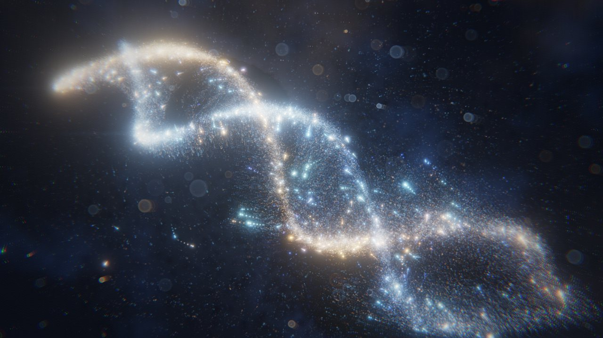

<sub><a href="../../README.md">← AIDIY</a></sub>



# GOD MODE — CONTROL THE UNIVERSE

A real-time GPU particle universe you create, collapse into a black hole, detonate and reshape with your mouse, keyboard, touch, or bare hands (webcam + MediaPipe).

## Run

```bash
cd space/god-mode
npm install
npm run dev        # http://localhost:5173  (also exposed on your LAN for phone testing)
npm run build      # typecheck + production bundle in dist/
npm run preview    # serve dist/
npm test           # gesture-recognition unit tests
```

The camera needs a secure origin: `localhost` works, a phone on the LAN needs HTTPS.

## Controls

| Action | Mouse / Keys | Touch | Hand (camera) |
|---|---|---|---|
| Disturb the field | move | drag | move hand |
| Vortex / spin up | hold left button | hold one finger | make a fist |
| Collapse → black hole | hold **Space**, right button, or the ◯ button | two fingers | **pinch** thumb + index |
| Detonate | release the hold · **E** · double-click | lift fingers | **open your palm** after pinching or a fist |
| Transform | **← / →**, **1–5**, or click a form name | fast horizontal flick | horizontal swipe |

Other keys: **R** replays the cinematic from the big bang · **H** hides the UI · **M** sound · **C** camera · **F** fullscreen.
If nobody touches anything for about 16 s, the autopilot takes over again.

## Recording a 15–30 s clip

1. Open in Chrome, press **F** for fullscreen, then **H** to hide the UI (or keep it for branding).
2. Turn **Sound** on if you want the synthesized score in the capture.
3. Press **R** and start recording. The autopilot follows this timeline:
   0–3 s birth · 3–7 s spin-up · 7–12 s collapse · 12 s detonation · 17 s DNA · 21 s Nebula · 25 s Singularity · 29 s Black Hole.
4. For 9:16, use DevTools device mode (e.g. 1080×1920) or a portrait window. The camera reframes itself and the DNA stands upright.
5. Set **Quality** to HIGH or ULTRA on a desktop GPU before recording. AUTO may step down while the screen recorder is busy.

## Art direction

| Dimension | What the frame does |
|---|---|
| Composition | Each form has its own *shot* (`app/CameraRig.ts`): lens, orbit angle, dutch tilt and an off-axis lens shift. Galaxy is a 3/4 hero placed off-centre, Black Hole and Singularity use a symmetric telephoto, DNA is a dutch-angle close-up, and Nebula is a wide-angle shot from inside the gas. Shots blend on critically damped springs. |
| Material | Stars follow a luminosity distribution: many faint stars and a few very bright ones. Each star has a slightly different colour temperature, and the brightest in-focus stars get six-point diffraction spikes. |
| Spatial depth | Depth of field turns out-of-focus stars into real bokeh discs. Absorbing dust lanes are drawn subtractively and redden the light behind them. A foreground layer of dust motes parallaxes against every camera move, and far structures fade toward blue (aerial perspective). |
| Rhythm | Collapse builds a heartbeat that speeds up as mass gathers. Detonation has two phases: a short implosion where the frame darkens and the sound drops out, then the blast. After impact the simulation drops into bullet-time slow motion. |
| Interaction feedback | A custom reticle follows the mouse or the tracked hand, tightens into a gravity well, and shows the collapse charge. Spacetime visibly bends under the reticle through a micro-lens. |
| Climax | The camera crane-descends at birth and does a Vertigo dolly-zoom during collapse. Cinemascope bars slide in, an anamorphic flare streaks across the frame, a white hit lands, debris rains past the lens and re-converges. Serif chapter cards punctuate each act. |

## Architecture

```
src/
  gpu/ParticleSim.ts     GPGPU position/velocity ping-pong (GPUComputationRenderer), size² particles
  gpu/ParticleField.ts   additive point sprites that read the sim textures in the vertex shader
  gpu/Backdrop.ts        star field + procedural deep-space dust
  gpu/PostFX.ts          trails → gravitational lens/shockwave/pointer lens → anamorphic flare → bloom → grade, letterbox
  shaders/shapes.glsl    the 5 forms, generated procedurally from per-particle seeds (shared by sim + render)
  shaders/velocity.glsl  springs to form targets, collapse gravity, vortex, turbulence, blast impulse
  app/Universe.ts        state machine: morphing, collapse charge, detonation, recovery
  app/Director.ts        cinematic autopilot
  app/CameraRig.ts       per-form shots, dolly-zoom, crane, blast kick, letterbox
  gpu/DepthLayers.ts     subtractive dust lanes + foreground bokeh motes
  app/Quality.ts         tiered particle counts (16k → 262k) with FPS-driven auto-scaling
  input/                 pointer/touch, MediaPipe hand tracker, pure gesture classifier (unit tested)
  audio/AudioEngine.ts   fully synthesized WebAudio score (no samples)
  fallback/LiteMode.ts   Canvas-2D fallback when WebGL2 / float render targets are unavailable
```

- Particles never touch the CPU per frame. Shapes are not stored anywhere: each particle maps its 8 random seeds to a target in every form. A morph is a staggered per-particle blend of targets, driven through spring physics and turbulence.
- The black hole is a screen-space lens. The lens bends the background around the event horizon and draws a shadow and a photon ring. Particles in front of the hole write a mask into the alpha channel, so the near side of the disk stays sharp in front of the shadow.
- The MediaPipe WASM runtime ships with the app. Only the ~8 MB hand model is fetched from Google's public model bucket, and only the first time you turn the camera on.
- Debug hook: in the browser console, `godMode.advance(seconds)` steps the simulation deterministically.
- Fallback: add `?lite` to the URL to force the Canvas-2D version.
